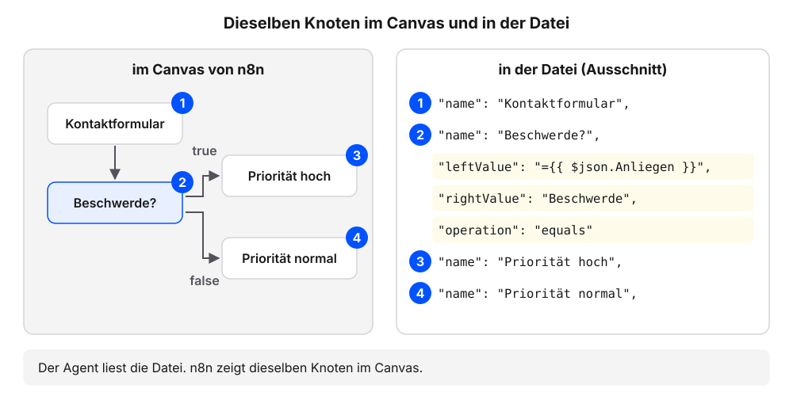
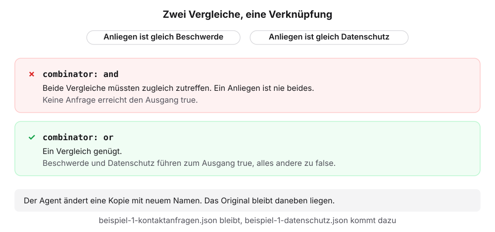
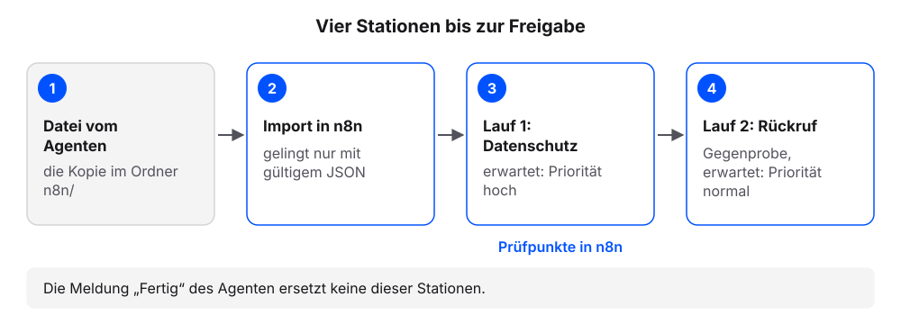
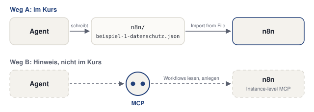
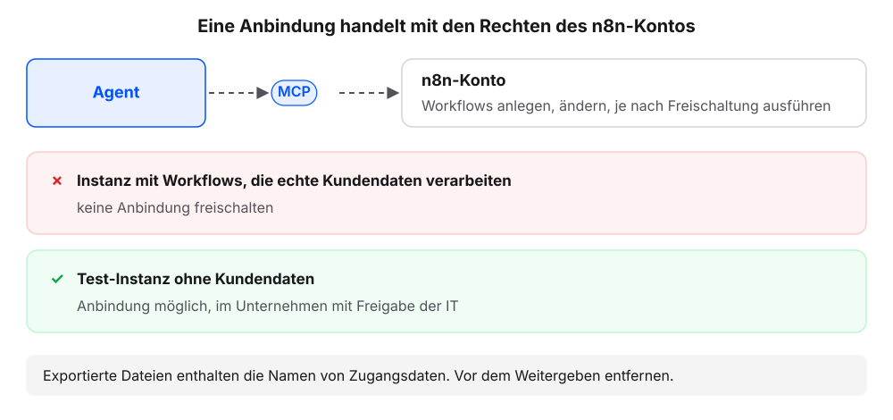

# n8n mit dem Agenten

Jeder n8n-Workflow lässt sich als Datei speichern. Für den Agenten ist diese Datei Text wie jede Anfrage im Projektordner.

In diesem Kapitel erklärt der eigene Agent den Workflow aus [Beispiel 1: Kontaktanfragen sortieren](../beispiele/kontaktanfragen.qmd) und ändert ihn als Kopie. Die Kopie soll eine dritte Art von Anfragen mit hoher Priorität behandeln: Datenschutzanfragen. Danach testen wir die Kopie in n8n. Die Erklärung folgt jeweils am eigenen Ergebnis.

Jeder Schritt hat denselben Aufbau: ein Auftrag zum Kopieren, ein Kasten „Das sollten wir jetzt sehen“, eine kurze Erklärung und ein Abschnitt „Wenn es anders aussieht“.

## Schritt 1: Workflow-Datei ablegen und erklären lassen

**Voraussetzung:** Der eigene Projektordner (Beispielfall: `kundenanfragen`) ist in der App des Agenten gewählt, mit dem Stand nach dem Kapitel [Voraussetzung: Ihre Arbeitsumgebung](voraussetzung.qmd).

1. Diesen Auftrag senden:

   ```text
   Lege in diesem Ordner den Ordner n8n an. Frage, bevor du ihn anlegst.
   ```

2. Die Datei [beispiel-1-kontaktanfragen.json](../workflows/beispiele/beispiel-1-kontaktanfragen.json) herunterladen (im Browser: rechte Maustaste, „Link speichern unter“).
3. Die Datei im Finder oder Explorer im Ordner `n8n/` des Projektordners speichern (Beispielfall: `kundenanfragen/n8n/`).
4. Diese Frage senden:

   ```text
   Liste die Dateien im Ordner n8n auf.
   ```

5. Prüfen: Die Liste nennt `beispiel-1-kontaktanfragen.json`.
6. Diesen Auftrag senden:

   ```text
   Erkläre den Workflow in n8n/beispiel-1-kontaktanfragen.json in drei Sätzen: Auslöser, Entscheidung, Ergebnis. Ändere danach nichts.
   ```

7. Prüfen: Die Erklärung nennt das Formular, den If-Knoten „Beschwerde?“ und zwei Ausgänge.

::: {.callout-note collapse="true" title="Alternative: Datei vom Agenten anlegen lassen"}
Statt Schritt 1 bis 3 kann der Agent die Datei selbst anlegen. Der Auftrag enthält den vollständigen Inhalt der Datei aus Beispiel 1; auf der Lernplattform ist er der Hauptweg.

```text
Lege den Ordner n8n an und darin die Datei beispiel-1-kontaktanfragen.json. Übernimm den Text zwischen BEGINN und ENDE wörtlich, ohne etwas zu ändern. Frage, bevor du etwas anlegst.

=== BEGINN ===
{
  "name": "Beispiel 1 · Kontaktanfragen sortieren",
  "nodes": [
    {
      "parameters": {
        "formTitle": "Kontakt",
        "formDescription": "Wir melden uns innerhalb eines Werktags.",
        "formFields": {
          "values": [
            {
              "fieldLabel": "Name",
              "requiredField": true
            },
            {
              "fieldLabel": "E-Mail",
              "fieldType": "email",
              "requiredField": true
            },
            {
              "fieldLabel": "Anliegen",
              "fieldType": "dropdown",
              "fieldOptions": {
                "values": [
                  {
                    "option": "Frage zur Bestellung"
                  },
                  {
                    "option": "Beschwerde"
                  },
                  {
                    "option": "Rückruf"
                  }
                ]
              },
              "requiredField": true
            },
            {
              "fieldLabel": "Nachricht",
              "fieldType": "textarea"
            }
          ]
        },
        "options": {}
      },
      "id": "form",
      "name": "Kontaktformular",
      "type": "n8n-nodes-base.formTrigger",
      "typeVersion": 2.2,
      "position": [
        0,
        0
      ],
      "webhookId": "e0160819-96b1-5a28-9571-24dd6a26c008"
    },
    {
      "parameters": {
        "conditions": {
          "options": {
            "caseSensitive": true,
            "leftValue": "",
            "typeValidation": "strict",
            "version": 2
          },
          "conditions": [
            {
              "id": "if-c1",
              "leftValue": "={{ $json.Anliegen }}",
              "rightValue": "Beschwerde",
              "operator": {
                "type": "string",
                "operation": "equals"
              }
            }
          ],
          "combinator": "and"
        },
        "options": {}
      },
      "id": "if",
      "name": "Beschwerde?",
      "type": "n8n-nodes-base.if",
      "typeVersion": 2.2,
      "position": [
        260,
        0
      ]
    },
    {
      "parameters": {
        "assignments": {
          "assignments": [
            {
              "id": "h1",
              "name": "name",
              "value": "={{ $json.Name }}",
              "type": "string"
            },
            {
              "id": "h2",
              "name": "email",
              "value": "={{ $json['E-Mail'] }}",
              "type": "string"
            },
            {
              "id": "h3",
              "name": "anliegen",
              "value": "={{ $json.Anliegen }}",
              "type": "string"
            },
            {
              "id": "h4",
              "name": "prioritaet",
              "value": "hoch",
              "type": "string"
            }
          ]
        },
        "options": {}
      },
      "id": "hoch",
      "name": "Priorität hoch",
      "type": "n8n-nodes-base.set",
      "typeVersion": 3.4,
      "position": [
        520,
        -100
      ]
    },
    {
      "parameters": {
        "assignments": {
          "assignments": [
            {
              "id": "n1",
              "name": "name",
              "value": "={{ $json.Name }}",
              "type": "string"
            },
            {
              "id": "n2",
              "name": "email",
              "value": "={{ $json['E-Mail'] }}",
              "type": "string"
            },
            {
              "id": "n3",
              "name": "anliegen",
              "value": "={{ $json.Anliegen }}",
              "type": "string"
            },
            {
              "id": "n4",
              "name": "prioritaet",
              "value": "normal",
              "type": "string"
            }
          ]
        },
        "options": {}
      },
      "id": "normal",
      "name": "Priorität normal",
      "type": "n8n-nodes-base.set",
      "typeVersion": 3.4,
      "position": [
        520,
        100
      ]
    }
  ],
  "connections": {
    "Kontaktformular": {
      "main": [
        [
          {
            "node": "Beschwerde?",
            "type": "main",
            "index": 0
          }
        ]
      ]
    },
    "Beschwerde?": {
      "main": [
        [
          {
            "node": "Priorität hoch",
            "type": "main",
            "index": 0
          }
        ],
        [
          {
            "node": "Priorität normal",
            "type": "main",
            "index": 0
          }
        ]
      ]
    }
  },
  "settings": {
    "executionOrder": "v1"
  },
  "pinData": {}
}
=== ENDE ===
```

Danach weiter mit Schritt 4.
:::

### Das sollten wir jetzt sehen

```{=html}
<style>
.cv{max-width:720px;margin:0 0 1rem;color:#1f2430;font-size:14px;line-height:1.45}
.cv *{box-sizing:border-box}
.cv-win{border:1px solid #dcd9d2;border-radius:12px;overflow:hidden;background:#fbfaf7}
.cv-win + .cv-win{margin-top:12px}
.cv-top{display:flex;align-items:center;gap:8px;padding:7px 12px;background:#f4f2ed;border-bottom:1px solid #dcd9d2;font-size:12px;color:#5b6170}
.cv-top b{color:#1f2430;font-weight:600;font-family:ui-monospace,SFMono-Regular,Menlo,monospace}
.cv-top span{margin-left:auto}
.cv-chat{padding:12px;display:grid;gap:8px}
.cv-msg{border-radius:10px;padding:8px 11px;max-width:94%}
.cv-msg p{margin:0 0 4px}.cv-msg p:last-child{margin:0}
.cv-me{justify-self:end;background:color-mix(in oklch,#23417a 14%,transparent)}
.cv-ag{justify-self:start;background:#f4f2ed;border:1px solid #dcd9d2}
.cv-who{display:block;font-size:11.5px;color:#5b6170;margin-bottom:2px}
.cv-tool{justify-self:start;font-family:ui-monospace,SFMono-Regular,Menlo,monospace;font-size:12px;color:#5b6170;padding:0 4px}
.cv-tool::before{content:"› ";color:#c8962f;font-weight:700}
.cv-ask{justify-self:stretch;border:1px solid #c8962f;border-radius:10px;padding:8px 11px;background:color-mix(in oklch,#c8962f 10%,#fbfaf7)}
.cv-btn{display:inline-block;margin:6px 6px 0 0;padding:2px 10px;border:1px solid #dcd9d2;border-radius:999px;font-size:12.5px;background:#fbfaf7}
.cv-btn.ok{border-color:#23417a;color:#23417a;font-weight:600}
.cv-leer{color:#5b6170;font-size:13px;padding:18px 0;text-align:center}
.cv-in{margin:4px 12px 12px;border:1px solid #dcd9d2;border-radius:999px;padding:7px 12px;color:#5b6170;font-size:13px}
.cv code{font-family:ui-monospace,SFMono-Regular,Menlo,monospace;font-size:.92em}
.cv pre{margin:6px 0 0;padding:8px 10px;border:1px solid #dcd9d2;border-radius:8px;background:#fbfaf7;font-family:ui-monospace,SFMono-Regular,Menlo,monospace;font-size:12.5px;line-height:1.6;white-space:pre-wrap;word-break:break-word}
.cv pre i{color:#23417a;font-style:normal;font-weight:700}
.cv pre em{color:#5b6170;font-style:normal}
.cv pre .nr{color:#5b6170;opacity:.6;display:inline-block;width:22px;user-select:none}
.cv pre .alt{display:block;background:color-mix(in oklch,#c8962f 22%,transparent);text-decoration:line-through;text-decoration-color:#5b6170}
.cv pre .neu{display:block;background:color-mix(in oklch,#23417a 16%,transparent)}
.cv pre .mark{background:color-mix(in oklch,#c8962f 24%,transparent)}
.cv-h{font-size:18px;font-weight:700;margin:4px 0 6px}
.cv-h2{font-size:15px;font-weight:700;margin:8px 0 4px}
.cv ul,.cv ol{margin:0;padding-left:20px}
.cv li{margin:2px 0}
.cv table{border-collapse:collapse;font-size:13px;margin-top:4px}
.cv th,.cv td{border:1px solid #dcd9d2;padding:4px 8px;text-align:left;vertical-align:top}
.cv th{background:#f4f2ed}
.cv-cap{margin:10px 0 0;font-size:13px;color:#5b6170}
</style>
<div class="cv">
<div class="cv-win" role="group" aria-label="Chat: Erklärung des Workflows in drei Sätzen und die Stelle in der Datei, aus der der Agent die Entscheidung liest">

<div class="cv-chat">
<div class="cv-msg cv-me"><span class="cv-who">Wir</span>Erkläre den Workflow in n8n/beispiel-1-kontaktanfragen.json in drei Sätzen: Auslöser, Entscheidung, Ergebnis. Ändere danach nichts.</div>
<div class="cv-tool">liest n8n/beispiel-1-kontaktanfragen.json</div>
<div class="cv-msg cv-ag"><span class="cv-who">Agent</span><p><b>Auslöser:</b> Das Formular „Kontaktformular“ startet den Workflow, wenn jemand Name, E-Mail, Anliegen und Nachricht absendet.</p><p><b>Entscheidung:</b> Der If-Knoten „Beschwerde?“ prüft, ob das Anliegen gleich „Beschwerde“ ist.</p><p><b>Ergebnis:</b> Beschwerden gehen an „Priorität hoch“, alle anderen Anfragen an „Priorität normal“. Beide Knoten setzen das Feld prioritaet.</p><p>Die Entscheidung steht in der Datei so (gekürzt):</p><pre>"name": "<i>Beschwerde?</i>",
"conditions": [
  {
    <span class="mark">"leftValue": "=&#123;&#123; $json.Anliegen &#125;&#125;",</span>
    <span class="mark">"rightValue": "Beschwerde",</span>
    "operator": { "type": "string", <span class="mark">"operation": "equals"</span> }
  }
],
"combinator": "and"</pre></div>
</div>
</div>
<p class="cv-cap">Die Erklärung Ihres Agenten lautet anders. Wichtig sind Auslöser, Entscheidung und die zwei Ausgänge. Die hinterlegten Zeilen zeigen, woher er die Entscheidung kennt: aus der Bedingung im If-Knoten.</p>
</div>
```

### Was gerade passiert ist

Der Agent hat die Workflow-Datei gelesen wie jede Anfrage im Ordner. Die Namen in seiner Erklärung stehen wörtlich in der Datei.

**Workflow-JSON** nennen wir die Datei, in der n8n einen Workflow speichert. JSON (JavaScript Object Notation) ist ein Textformat, das Daten als Felder mit Namen und Wert in geschweiften Klammern ablegt. Die Datei enthält alle Knoten mit ihren Einstellungen und die Verbindungen zwischen ihnen. Jeder Workflow lässt sich über das Menü des Workflows als JSON-Datei exportieren und in eine andere Instanz wieder importieren. Die Knotennamen in der Datei sind dieselben wie im Canvas.

{fig-alt="Links vier Knoten im Canvas von n8n, nummeriert: 1 Kontaktformular, 2 Beschwerde?, von dort true zu 3 Priorität hoch und false zu 4 Priorität normal. Rechts ein Ausschnitt der Datei mit denselben Nummern an den Zeilen name: Kontaktformular, Beschwerde?, Priorität hoch, Priorität normal. Hinterlegt die Bedingung des If-Knotens: leftValue Anliegen, rightValue Beschwerde, operation equals. Unten: Der Agent liest die Datei, n8n zeigt dieselben Knoten im Canvas."}

Die **Bedingung** ist der Vergleich im If-Knoten „Beschwerde?“. In der Datei sieht sie so aus (gekürzt):

```json
"conditions": [
  {
    "leftValue": "={{ $json.Anliegen }}",
    "rightValue": "Beschwerde",
    "operator": { "type": "string", "operation": "equals" }
  }
],
"combinator": "and"
```

Erläuterung:

- `leftValue` ist der Wert aus dem Formularfeld `Anliegen`.
- `rightValue` ist der Vergleichswert `Beschwerde`.
- `operation` legt den Vergleich fest, hier „ist gleich“ (`equals`).

Der Agent liest den Ablauf zuerst und erklärt ihn, bevor er etwas ändert, ähnlich wie ein neuer Mitarbeiter, der sich einen Ablaufplan erklären lässt. Seine Erklärung lässt sich am Canvas in n8n prüfen.

::: {.callout-note title="Wenn es anders aussieht"}
- Der Agent kürzt die Datei oder ändert Zeilen beim Anlegen (Alternative oben): ablehnen und die Datei herunterladen.
- Die heruntergeladene Datei heißt `beispiel-1-kontaktanfragen.json.txt` oder liegt noch im Download-Ordner: im Finder oder Explorer in den Ordner `n8n/` des Projektordners verschieben und die Endung `.txt` entfernen.
- Die Erklärung nennt andere Namen als „Beschwerde?“ oder „Priorität hoch“: „Nenne die Knotennamen genau so, wie sie in der Datei stehen.“
- Der Agent schlägt von sich aus eine Änderung vor: ablehnen. Der Auftrag lautet „Ändere danach nichts“.
:::

## Schritt 2: Eine geänderte Kopie anlegen lassen

Aus dem Quiz in Beispiel 1 bekannt: Auch Datenschutzanfragen sollen hohe Priorität bekommen.

**Voraussetzung:** `n8n/beispiel-1-kontaktanfragen.json` aus Schritt 1 liegt im Projektordner.

1. Diesen Auftrag senden:

   ```text
   Erstelle eine Kopie als n8n/beispiel-1-datenschutz.json. Änderung: Der If-Knoten „Beschwerde?“ prüft zusätzlich, ob Anliegen gleich „Datenschutz“ ist, beide Bedingungen mit OR. Das Formular bekommt die Option „Datenschutz“. Sonst nichts ändern. Nenne mir die beiden Stellen, die du geändert hast.
   ```

2. Das Anlegen freigeben, wenn der Agent fragt.
3. Prüfen: Der Agent nennt zwei Stellen, die neue Formularoption und die zweite Bedingung im If-Knoten.
4. Diese Frage senden:

   ```text
   Zeig mir aus n8n/beispiel-1-datenschutz.json alle Zeilen mit „Datenschutz“ und die Zeile mit „combinator“, genau so, wie sie in der Datei stehen. Liste danach die Dateien im Ordner n8n auf.
   ```

5. Prüfen: Die Zeilen enthalten `"option": "Datenschutz"`, `"rightValue": "Datenschutz"` und `"combinator": "or"`.
6. Prüfen: Die Liste nennt `beispiel-1-kontaktanfragen.json` und `beispiel-1-datenschutz.json`.

### Das sollten wir jetzt sehen

```{=html}
<style>
.cv{max-width:720px;margin:0 0 1rem;color:#1f2430;font-size:14px;line-height:1.45}
.cv *{box-sizing:border-box}
.cv-win{border:1px solid #dcd9d2;border-radius:12px;overflow:hidden;background:#fbfaf7}
.cv-win + .cv-win{margin-top:12px}
.cv-top{display:flex;align-items:center;gap:8px;padding:7px 12px;background:#f4f2ed;border-bottom:1px solid #dcd9d2;font-size:12px;color:#5b6170}
.cv-top b{color:#1f2430;font-weight:600;font-family:ui-monospace,SFMono-Regular,Menlo,monospace}
.cv-top span{margin-left:auto}
.cv-chat{padding:12px;display:grid;gap:8px}
.cv-msg{border-radius:10px;padding:8px 11px;max-width:94%}
.cv-msg p{margin:0 0 4px}.cv-msg p:last-child{margin:0}
.cv-me{justify-self:end;background:color-mix(in oklch,#23417a 14%,transparent)}
.cv-ag{justify-self:start;background:#f4f2ed;border:1px solid #dcd9d2}
.cv-who{display:block;font-size:11.5px;color:#5b6170;margin-bottom:2px}
.cv-tool{justify-self:start;font-family:ui-monospace,SFMono-Regular,Menlo,monospace;font-size:12px;color:#5b6170;padding:0 4px}
.cv-tool::before{content:"› ";color:#c8962f;font-weight:700}
.cv-ask{justify-self:stretch;border:1px solid #c8962f;border-radius:10px;padding:8px 11px;background:color-mix(in oklch,#c8962f 10%,#fbfaf7)}
.cv-btn{display:inline-block;margin:6px 6px 0 0;padding:2px 10px;border:1px solid #dcd9d2;border-radius:999px;font-size:12.5px;background:#fbfaf7}
.cv-btn.ok{border-color:#23417a;color:#23417a;font-weight:600}
.cv-leer{color:#5b6170;font-size:13px;padding:18px 0;text-align:center}
.cv-in{margin:4px 12px 12px;border:1px solid #dcd9d2;border-radius:999px;padding:7px 12px;color:#5b6170;font-size:13px}
.cv code{font-family:ui-monospace,SFMono-Regular,Menlo,monospace;font-size:.92em}
.cv pre{margin:6px 0 0;padding:8px 10px;border:1px solid #dcd9d2;border-radius:8px;background:#fbfaf7;font-family:ui-monospace,SFMono-Regular,Menlo,monospace;font-size:12.5px;line-height:1.6;white-space:pre-wrap;word-break:break-word}
.cv pre i{color:#23417a;font-style:normal;font-weight:700}
.cv pre em{color:#5b6170;font-style:normal}
.cv pre .nr{color:#5b6170;opacity:.6;display:inline-block;width:22px;user-select:none}
.cv pre .alt{display:block;background:color-mix(in oklch,#c8962f 22%,transparent);text-decoration:line-through;text-decoration-color:#5b6170}
.cv pre .neu{display:block;background:color-mix(in oklch,#23417a 16%,transparent)}
.cv pre .mark{background:color-mix(in oklch,#c8962f 24%,transparent)}
.cv-h{font-size:18px;font-weight:700;margin:4px 0 6px}
.cv-h2{font-size:15px;font-weight:700;margin:8px 0 4px}
.cv ul,.cv ol{margin:0;padding-left:20px}
.cv li{margin:2px 0}
.cv table{border-collapse:collapse;font-size:13px;margin-top:4px}
.cv th,.cv td{border:1px solid #dcd9d2;padding:4px 8px;text-align:left;vertical-align:top}
.cv th{background:#f4f2ed}
.cv-cap{margin:10px 0 0;font-size:13px;color:#5b6170}
</style>
<div class="cv">
<div class="cv-win" role="group" aria-label="Chat: Rückfrage vor dem Anlegen der Kopie, die zwei geänderten Stellen und die Liste der zwei Dateien">

<div class="cv-chat">
<div class="cv-msg cv-me"><span class="cv-who">Wir</span>Erstelle eine Kopie als n8n/beispiel-1-datenschutz.json. Änderung: Der If-Knoten „Beschwerde?“ prüft zusätzlich, ob Anliegen gleich „Datenschutz“ ist, beide Bedingungen mit OR. Das Formular bekommt die Option „Datenschutz“. Sonst nichts ändern. Nenne mir die beiden Stellen, die du geändert hast.</div>
<div class="cv-tool">liest n8n/beispiel-1-kontaktanfragen.json</div>
<div class="cv-ask"><span class="cv-who">Agent</span>Ich lege <code>n8n/beispiel-1-datenschutz.json</code> an: eine Kopie mit zwei Änderungen, das Original bleibt unverändert. Darf ich?<br><span class="cv-btn ok">Erlauben</span><span class="cv-btn">Ablehnen</span></div>
<div class="cv-tool">beispiel-1-datenschutz.json angelegt</div>
<div class="cv-msg cv-ag"><span class="cv-who">Agent</span><p>Fertig. Zwei Stellen geändert:</p><ol><li>Kontaktformular, Feld Anliegen: neue Option „Datenschutz“.</li><li>If-Knoten „Beschwerde?“: zweiter Vergleich Anliegen gleich „Datenschutz“, Verknüpfung von and auf or.</li></ol><p><code>beispiel-1-kontaktanfragen.json</code> ist unverändert.</p></div>
<div class="cv-msg cv-me"><span class="cv-who">Wir</span>Zeig mir aus n8n/beispiel-1-datenschutz.json alle Zeilen mit „Datenschutz“ und die Zeile mit „combinator“, genau so, wie sie in der Datei stehen. Liste danach die Dateien im Ordner n8n auf.</div>
<div class="cv-msg cv-ag"><span class="cv-who">Agent</span><pre><em>Kontaktformular, Feld Anliegen</em>
{ "option": "<i>Datenschutz</i>" }
<em>If-Knoten Beschwerde?</em>
"rightValue": "<i>Datenschutz</i>",
"combinator": "<i>or</i>"</pre><p>Im Ordner <code>n8n/</code>: <code>beispiel-1-kontaktanfragen.json</code>, <code>beispiel-1-datenschutz.json</code>.</p></div>
</div>
</div>
<p class="cv-cap">Gekürzt. In der echten Datei stehen die Felder auf mehreren Zeilen, und der neue Vergleich hat meist eine eigene id. Wichtig sind die drei Werte Datenschutz, Datenschutz und or sowie die zwei Dateien.</p>
</div>
```

### Was gerade passiert ist

Der Agent hat die alte Bedingung gelesen und eine neue Datei mit zwei Änderungen angelegt. Das Original liegt unverändert daneben.

Das Feld **combinator** legt fest, wie mehrere Vergleiche im If-Knoten zusammenwirken. Mit `and` (und) müssen alle zutreffen, mit `or` (oder) genügt einer. Bei nur einem Vergleich spielt das keine Rolle. Bei zwei Vergleichen bestimmt dieses Feld das Ergebnis: Mit `or` führt jetzt Beschwerde oder Datenschutz zum Ausgang true.

{fig-alt="Zwei Vergleiche: Anliegen ist gleich Beschwerde und Anliegen ist gleich Datenschutz. Als falsch markiert: combinator and; beide Vergleiche müssten zugleich zutreffen, ein Anliegen ist nie beides, keine Anfrage erreicht den Ausgang true. Als richtig markiert: combinator or; ein Vergleich genügt, Beschwerde und Datenschutz führen zum Ausgang true, alles andere zu false. Unten: Der Agent ändert eine Kopie mit neuem Namen, das Original bleibt daneben liegen."}

Der Agent ändert eine **Kopie mit neuem Namen**, das Original bleibt, wie es ist (Grundregel 4 der AGENTS.md aus dem Buch „Produktiv mit einem Agenten arbeiten“, Kapitel [AGENTS.md: die Hausordnung](https://kirenz.github.io/agent-arbeitsumgebung/agent-arbeitsumgebung/agents-md.html)). So haben wir einen Vergleich und einen Rückweg, falls die Kopie nicht funktioniert. Die beiden Stellen im Überblick:

| Stelle | Original | Kopie |
|---|---|---|
| Formularfeld `Anliegen` | drei Optionen: Frage zur Bestellung, Beschwerde, Rückruf | vierte Option `Datenschutz` |
| If-Knoten „Beschwerde?“ | ein Vergleich: Anliegen ist gleich `Beschwerde`, `combinator: and` | zweiter Vergleich: Anliegen ist gleich `Datenschutz`, `combinator: or` |

::: {.callout-note title="Wenn es anders aussieht"}
- Der Agent hat das Original geändert: das Original mit Schritt 1 neu anlegen und den Auftrag aus Schritt 2 wiederholen.
- `"combinator"` steht noch auf `"and"`: Dann müssen beide Vergleiche zugleich zutreffen, und keine Anfrage landet in „Priorität hoch“. „Setze combinator im If-Knoten auf or.“
- Der Agent nennt mehr als zwei Stellen: sich die alten und neuen Zeilen zeigen lassen und jede weitere Änderung zurücknehmen lassen.
- Der neue Vergleich hat eine eigene `id` oder steht über mehrere Zeilen verteilt: Das ist in Ordnung.
:::

## Schritt 3: In n8n importieren und zweimal testen

**Voraussetzung:** Die Anmeldung in der eigenen n8n-Instanz ist erfolgt. `n8n/beispiel-1-datenschutz.json` aus Schritt 2 liegt im Projektordner.

1. In n8n einen neuen Workflow öffnen.
2. Im Drei-Punkte-Menü oben rechts **Import from File** wählen und dann die Datei `n8n/beispiel-1-datenschutz.json` im Projektordner (Beispielfall: `kundenanfragen/n8n/beispiel-1-datenschutz.json`).
3. Prüfen: Der Canvas zeigt vier Knoten: Kontaktformular, Beschwerde?, Priorität hoch, Priorität normal.
4. Unten auf **Execute workflow** klicken. n8n öffnet das Formular in einem neuen Tab.
5. Das Formular ausfüllen: Testwerte für Name und E-Mail, Anliegen **Datenschutz**. Absenden.
6. In n8n den Knoten **Priorität hoch** öffnen.
7. Prüfen: Die Ausgabe (OUTPUT) zeigt `prioritaet` mit dem Wert `hoch`.
8. Schritt 4 bis 6 mit dem Anliegen **Rückruf** und dem Knoten **Priorität normal** wiederholen.
9. Prüfen: Die Ausgabe zeigt `anliegen` mit `Rückruf` und `prioritaet` mit `normal`.

Besteht Prüfung 7 nicht, bekommt der Agent den Befund, etwa „Datenschutz landet in Priorität normal. Prüfe die Bedingung im If-Knoten.“ Danach die korrigierte Datei erneut importieren.

### Das sollten wir jetzt sehen

```{=html}
<style>
.bx{max-width:820px;margin:0 auto;color:#1f2430;font-size:14px;line-height:1.45}
.bx *{box-sizing:border-box}
.bx-grid{display:grid;grid-template-columns:1fr 1fr;gap:12px}
.bx-box{border:1px solid #dcd9d2;border-radius:12px;overflow:hidden;background:#fbfaf7;min-width:0}
.bx-bar{padding:6px 12px;background:#f4f2ed;border-bottom:1px solid #dcd9d2;font-size:12px;color:#5b6170}
.bx-bar b{color:#1f2430;font-weight:600;font-family:ui-monospace,SFMono-Regular,Menlo,monospace}
.bx pre{margin:0;padding:10px 12px;font-family:ui-monospace,SFMono-Regular,Menlo,monospace;font-size:12.5px;line-height:1.6;white-space:pre-wrap;word-break:break-word;background:transparent;border:0;color:#1f2430}
.bx pre i{color:#23417a;font-style:normal;font-weight:700}
.bx pre em{color:#5b6170;font-style:normal}
.bx pre .alt{display:block;background:color-mix(in oklch,#c8962f 22%,transparent);text-decoration:line-through;text-decoration-color:#5b6170}
.bx pre .neu{display:block;background:color-mix(in oklch,#23417a 16%,transparent)}
.bx pre .mark{background:color-mix(in oklch,#23417a 16%,transparent)}
.bx pre .weg{color:#5b6170;text-decoration:line-through}
.bx-body{padding:12px 16px 14px;font-size:14.5px}
.bx-body p{margin:0 0 8px}
.bx-body p:last-child{margin-bottom:0}
.bx-h{font-size:20px;font-weight:700;margin:0 0 8px}
.bx-h2{font-size:16px;font-weight:700;margin:10px 0 6px}
.bx ul,.bx ol{margin:0;padding-left:22px}
.bx li{margin:2px 0}
.bx table{border-collapse:collapse;font-size:13px;width:100%}
.bx th,.bx td{border:1px solid #dcd9d2;padding:5px 8px;text-align:left;vertical-align:top}
.bx th{background:#f4f2ed}
.bx code{font-family:ui-monospace,SFMono-Regular,Menlo,monospace;font-size:12.5px}
.bx-tag{display:inline-block;margin-left:6px;padding:0 6px;border-radius:999px;background:#f4f2ed;border:1px solid #dcd9d2;font-size:11px;color:#5b6170}
.bx-ok{color:#23417a;font-weight:700}
.bx-flow{display:flex;flex-wrap:wrap;align-items:center;gap:6px;padding:10px 12px;font-size:12.5px}
.bx-node{padding:4px 9px;border:1px solid #dcd9d2;border-radius:8px;background:#f4f2ed}
.bx-node.an{border-color:#23417a;background:color-mix(in oklch,#23417a 12%,#fbfaf7);font-weight:600}
.bx-arr{color:#5b6170}
.bx-cap{margin:10px 0 0;font-size:13px;color:#5b6170}
@media (max-width:640px){.bx-grid{grid-template-columns:1fr}}
</style>
<div class="bx" style="margin:0 0 1rem">
<div class="bx-grid" role="group" aria-label="Ergebnis der zwei Testläufe in n8n">
<div class="bx-box"><div class="bx-bar">Lauf 1: Anliegen <b>Datenschutz</b></div>
<div class="bx-flow"><span class="bx-node">Kontaktformular</span><span class="bx-arr">→</span><span class="bx-node">Beschwerde?</span><span class="bx-arr">→ true →</span><span class="bx-node an">Priorität hoch</span></div>
<pre><em>OUTPUT von Priorität hoch, Ansicht JSON</em>
[
  {
    "name": "Test",
    "email": "test@example.com",
    "anliegen": "Datenschutz",
    <span class="mark">"prioritaet": "hoch"</span>
  }
]</pre></div>
<div class="bx-box"><div class="bx-bar">Lauf 2: Anliegen <b>Rückruf</b></div>
<div class="bx-flow"><span class="bx-node">Kontaktformular</span><span class="bx-arr">→</span><span class="bx-node">Beschwerde?</span><span class="bx-arr">→ false →</span><span class="bx-node an">Priorität normal</span></div>
<pre><em>OUTPUT von Priorität normal, Ansicht JSON</em>
[
  {
    "name": "Test",
    "email": "test@example.com",
    "anliegen": "Rückruf",
    <span class="mark">"prioritaet": "normal"</span>
  }
]</pre></div>
</div>
<p class="bx-cap">Im Canvas tragen die durchlaufenen Knoten nach dem Lauf einen grünen Haken. Die Ausgabe steht im Knoten unter OUTPUT. Name und E-Mail sind die eigenen Testwerte.</p>
</div>
```

### Was gerade passiert ist

Aus der Datei des Agenten ist ein Workflow in der eigenen Instanz geworden, und zwei Läufe haben sein Verhalten gezeigt.

Beim **Import** liest n8n die JSON-Datei und baut daraus Knoten und Verbindungen im Canvas. Das gelingt nur, wenn die Datei gültiges JSON ist. Schon ein fehlendes Komma verhindert den Import. Damit ist der Import der erste Prüfpunkt.

Der zweite Lauf ist eine **Gegenprobe** mit einem Anliegen, für das sich nichts ändern soll. Er zeigt, ob die Änderung nur dort wirkt, wo sie wirken soll.

{fig-alt="Vier nummerierte Stationen von links nach rechts: 1 Datei vom Agenten, die Kopie im Ordner n8n. 2 Import in n8n, gelingt nur mit gültigem JSON. 3 Lauf 1 mit Datenschutz, erwartet Priorität hoch. 4 Lauf 2 mit Rückruf als Gegenprobe, erwartet Priorität normal. Station 2 bis 4 sind Prüfpunkte in n8n. Unten: Die Meldung Fertig des Agenten ersetzt keine dieser Stationen."}

Die Meldung des Agenten „Fertig, beide Stellen sind angepasst“ ersetzt diese Läufe nicht. Auch das Durchlesen der Datei reicht nicht aus. Es zeigt weder, ob n8n die Datei annimmt, noch, ob die übrigen Anliegen weiter in „Priorität normal“ landen. Wir geben eine Änderung daher erst nach den beiden Testläufen frei.

::: {.callout-note title="Wenn es anders aussieht"}
- n8n meldet beim Import einen Fehler oder zeigt keine Knoten: Meist ist das JSON nicht gültig, etwa durch ein fehlendes Komma. Dem Agenten die Fehlermeldung senden und die korrigierte Datei importieren.
- Im Formular fehlt die Option Datenschutz: Die erste Änderung fehlt in der Datei. Den Befund an den Agenten senden.
- Der Knoten zeigt keine Ausgabe: Der Lauf hat diesen Knoten nicht erreicht. Den anderen Ausgangsknoten öffnen und dort prüfen.
- Das Formular öffnet sich nicht: prüfen, ob der Browser den neuen Tab blockiert hat.
:::

## Zwei Wege zu n8n

Bisher hat der Agent die Datei geschrieben, und wir haben sie importiert (Weg A). Daneben gibt es eine direkte Anbindung an n8n (Weg B).

{fig-alt="Zwei Wege. Weg A, im Kurs: Der Agent schreibt die Datei n8n/beispiel-1-datenschutz.json, wir importieren sie mit Import from File in n8n. Weg B, gestrichelt, nur Hinweis: Der Agent erreicht n8n über einen MCP-Zugang (Zugangskarte) und liest oder legt Workflows direkt an; in n8n heißt die Anbindung Instance-level MCP."}

| | Weg A: Datei und Import | Weg B: direkte Anbindung |
|---|---|---|
| Was der Agent tut | schreibt eine JSON-Datei in den Ordner `n8n/` | liest und legt Workflows direkt in n8n an |
| Was wir tun | importieren die Datei mit **Import from File** | schalten die Anbindung in n8n frei |
| Was gebraucht wird | nur den Projektordner | einen MCP-Server (siehe im Buch „Produktiv mit einem Agenten arbeiten“ das Kapitel [MCP: Zugänge zu anderen Systemen](https://kirenz.github.io/agent-arbeitsumgebung/agent-arbeitsumgebung/mcp.html)) und eine Freischaltung in n8n |
| Rolle hier | Praxisweg | freiwillige Prüfung am Ende |

Für Weg B bietet n8n eine eigene Anbindung namens **Instance-level MCP**. Sie macht die ganze n8n-Instanz zu einem MCP-Server und wird je Instanz und je Workflow freigeschaltet ([Anleitung in der n8n-Dokumentation](https://docs.n8n.io/connect/connect-to-n8n-mcp-server)). Wir bleiben bei Weg A. Er funktioniert mit jedem Agenten und jeder n8n-Instanz, und der Import in n8n bildet einen eigenen Prüfpunkt.

{fig-alt="Oben der Agent, über MCP verbunden mit einem n8n-Konto, das Workflows anlegen, ändern und je nach Freischaltung ausführen darf. Als falsch markiert: Instanz mit Workflows, die echte Kundendaten verarbeiten; keine Anbindung freischalten. Als richtig markiert: Test-Instanz ohne Kundendaten; Anbindung möglich, im Unternehmen mit Freigabe der IT. Unten: Exportierte Dateien enthalten die Namen von Zugangsdaten, vor dem Weitergeben entfernen."}

::: {.callout-warning title="Agent mit Zugriff auf n8n"}
- Eine n8n-Anbindung (Weg B) handelt mit den Rechten des eigenen n8n-Kontos. Sie kann Workflows anlegen und ändern, je nach Freischaltung auch ausführen.
- Die Anbindung nur in einer Test-Instanz freischalten oder mit Freigabe der IT. Workflows, die echte Kundendaten verarbeiten, bleiben ohne Anbindung.
- Exportierte Workflow-Dateien enthalten die Namen hinterlegter Zugangsdaten (Credentials), aber keine Passwörter. Vor dem Weitergeben einer Datei diese Namen entfernen.
:::

## Weg B: Anbindung erfragen (freiwillig)

Ob der eigene Agent schon eine Verbindung zu n8n hat, lässt sich ohne Risiko herausfinden. Beide Aufträge lesen nur.

::: {.callout-tip title="Den Agenten fragen"}
```text
Nur lesen und auflisten, nichts ändern. Hast du eine Anbindung an n8n (MCP-Server oder Werkzeug), mit der du Workflows lesen oder anlegen kannst? Nur antworten, nichts aufrufen.
```
:::

1. Die Frage aus dem Kasten „Den Agenten fragen“ senden.
2. Prüfen: Die Antwort sagt ja oder nein. Bei nein endet die Aufgabe hier.
3. Bei ja: diesen Auftrag senden:

   ```text
   Nur lesen und auflisten, nichts ändern. Liste über die n8n-Anbindung den Workflow „Kontaktanfragen sortieren“ aus Beispiel 1 auf: Namen der Knoten und ihre Verbindungen. Nichts anlegen, nichts ändern, nichts ausführen.
   ```

**Prüfkriterium:** Die Antwort nennt die vier Knoten aus Beispiel 1, und der Agent hat vor dem Aufruf gefragt.
