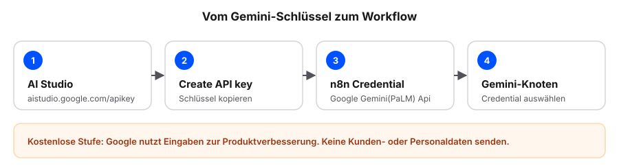
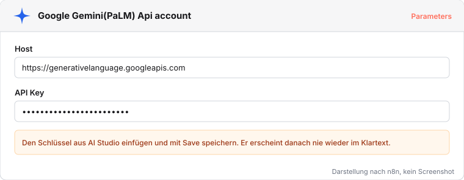

# Gemini-Schlüssel einrichten

Beispiel 4 und 5 nutzen ein KI-Modell von Google. Dafür braucht n8n einen API-Schlüssel. Das ist eine lange Zeichenfolge, mit der sich n8n bei Google ausweist, ähnlich wie ein Passwort.

Wir erzeugen ihn einmal kostenlos in Google AI Studio und hinterlegen ihn als Credential in n8n. Beide Beispiele nutzen danach dasselbe Credential.

## Google AI Studio

AI Studio ist eine Webseite von Google. Dort lassen sich die Gemini-Modelle ausprobieren und Schlüssel für die Nutzung in anderen Programmen erzeugen. Ein Google-Konto genügt, eine Kreditkarte ist nicht nötig.

Die Nutzung ist bis zu einer bestimmten Zahl von Anfragen pro Minute und Tag kostenlos. Für die Beispiele reicht das. Wird die Grenze erreicht, meldet n8n einen Fehler. Nach kurzer Wartezeit lassen sich wieder Anfragen senden.

## Schlüssel erzeugen

Voraussetzung: ein Google-Konto.

1. Die Seite API Keys in AI Studio öffnen: <https://aistudio.google.com/apikey>.
2. Mit dem Google-Konto anmelden.
3. Beim ersten Besuch die Nutzungsbedingungen bestätigen. AI Studio legt dabei ein Standardprojekt an.
4. Auf **Create API key** klicken.
5. Das vorgeschlagene Projekt wählen, falls AI Studio danach fragt.
6. Den Schlüssel kopieren.

**Prüfen:** Auf der Seite API Keys steht der neue Schlüssel.

## Credential in n8n anlegen

1. In n8n die **Credentials** öffnen und auf **Create credential** klicken.
2. Nach Gemini suchen und **Google Gemini(PaLM) Api** wählen.
3. Den Schlüssel in das Feld **API Key** einfügen.
4. **Host** unverändert lassen (`https://generativelanguage.googleapis.com`).
5. Auf **Save** klicken.

**Prüfen:** n8n meldet einen erfolgreichen Verbindungstest, und das Credential erscheint in der Liste.

::: {.callout-warning title="Schlüssel und Daten schützen"}
Den Schlüssel behandeln wir wie ein Passwort und geben ihn nicht weiter [@geminiApiKey]. Im Workflow steht nie der Schlüssel, nur der Name des Credentials. In der kostenlosen Stufe nutzt Google Eingaben zur Produktverbesserung; wir senden deshalb nur Übungsdaten, keine Kunden- oder Personaldaten.
:::
