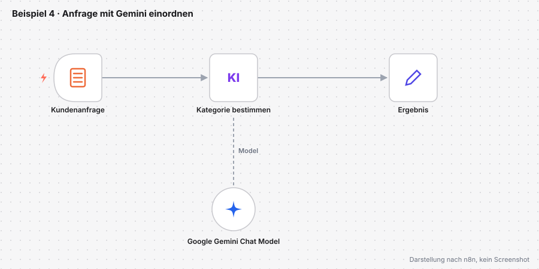
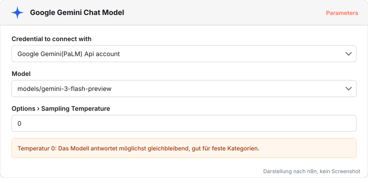
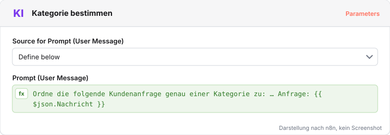

# Beispiel 4: Anfrage mit Gemini einordnen

Kundinnen und Kunden schreiben frei, worum es geht. Eine feste Regel scheitert daran, ein Sprachmodell kann den Text einordnen: Lieferung, Rücksendung, Rechnung oder Sonstiges. Wir nutzen ein Modell von Google; das Credential dafür haben wir in [Gemini-Schlüssel einrichten](gemini-schluessel.qmd) angelegt.

Datei: [beispiel-4-ki-einordnen.json](../workflows/beispiele/beispiel-4-ki-einordnen.json)

## Hochladen und verbinden

1. Datei herunterladen, neuen Workflow öffnen, **Import from File…** wählen.
2. Im Knoten **Google Gemini Chat Model** das eigene Gemini-Credential wählen und, falls nötig, ein aktuelles Flash-Modell aus der Liste.
3. Mit **Execute workflow** das Formular öffnen und eine Übungsanfrage senden, etwa `Mein Paket ist seit einer Woche unterwegs, wann kommt es an?`

::: {.callout-warning title="Nur Übungsdaten"}
In der kostenlosen Stufe nutzt Google Eingaben zur Produktverbesserung. Wir senden nur Übungstexte, keine Kunden- oder Personaldaten.
:::

## Prompt und Modell

Der Knoten **Kategorie bestimmen** (Basic LLM Chain) schickt einen Auftrag an das Modell: Der Prompt nennt die erlaubten Kategorien und fügt per Expression die Nachricht aus dem Formular ein. Das Modell hängt als eigener Knoten unter der Kette und liefert die Antwort, die als Feld `text` weiterwandert. Eine Temperatur von 0 macht die Antworten möglichst gleichbleibend.

