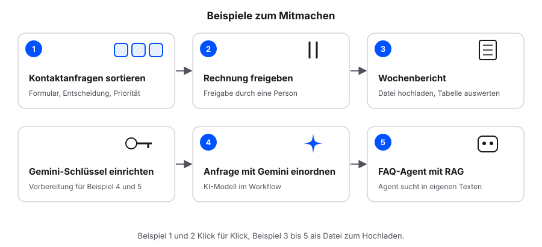

# Beispiele zum Mitmachen {.unnumbered}

Nach dem ersten Workflow bauen wir fünf kleine Abläufe aus dem Alltag des Online-Shops. Beispiel 1 und 2 bauen wir Klick für Klick nach. Beispiel 3 bis 5 sind umfangreicher: Wir laden die fertige Datei in n8n hoch und gehen den Workflow Knoten für Knoten durch. Alle Beispiele laufen in der Testphase von n8n Cloud; Für Beispiel 4 und 5 richten wir vorher einmal einen kostenlosen Schlüssel ein: [Gemini-Schlüssel einrichten](gemini-schluessel.qmd).

## Eine Datei in n8n hochladen

1. Die Workflow-Datei (JSON) herunterladen.
2. In n8n einen neuen Workflow öffnen.
3. Oben rechts im Drei-Punkte-Menü **Import from File…** wählen und die Datei auswählen.
4. Zugangsdaten (Credentials) und Tabellen nach dem Import einmal zuordnen. Sie sind nie Teil der Datei.

Die Abbildungen in diesem Teil sind nach n8n nachgezeichnet, keine Screenshots. Je nach n8n-Version heißen einzelne Felder leicht anders; die fertigen Dateien dienen dann als Vergleich.
