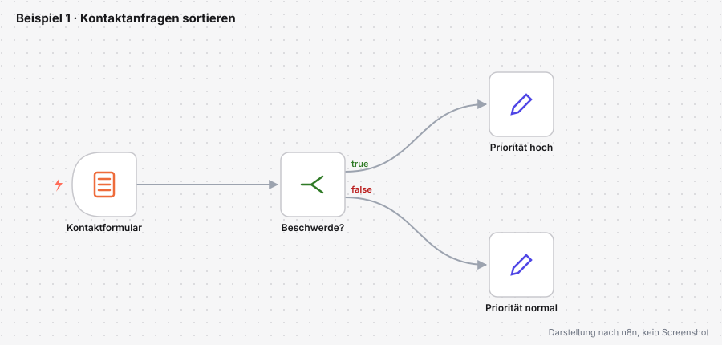
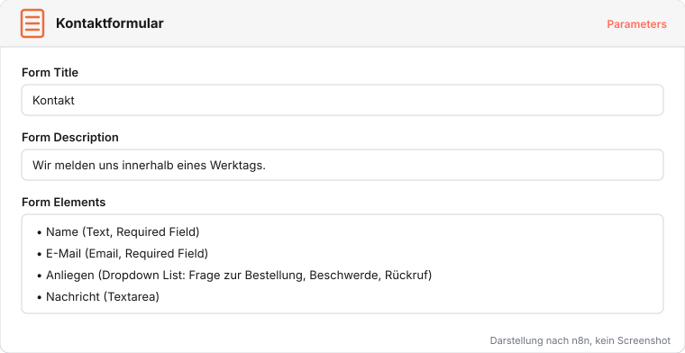
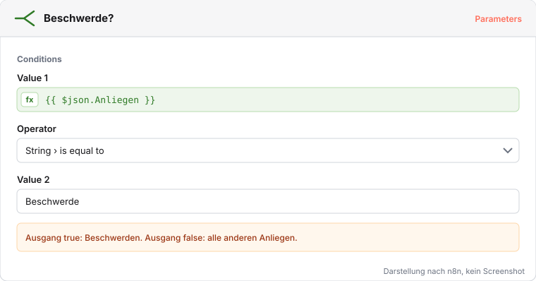
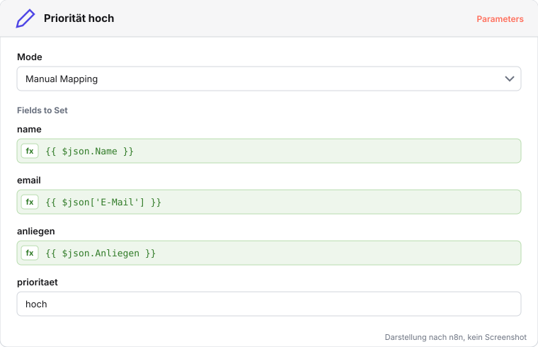

# Beispiel 1: Kontaktanfragen sortieren

Über das Kontaktformular kommen jeden Tag Anfragen. Beschwerden sollen sofort auffallen, alles andere hat normale Priorität. Der Workflow nimmt die Anfrage aus einem Formular entgegen, prüft das Anliegen und setzt die Priorität.

Fertige Datei zum Vergleich: [beispiel-1-kontaktanfragen.json](../workflows/beispiele/beispiel-1-kontaktanfragen.json)

## Formular anlegen

1. Einen neuen Workflow öffnen und in **Kontaktanfragen sortieren** umbenennen.
2. Über das Plus-Symbol den Trigger **On form submission** einfügen und in **Kontaktformular** umbenennen.
3. **Form Title** `Kontakt`, **Form Description** `Wir melden uns innerhalb eines Werktags.`
4. Vier Form Elements anlegen: `Name` (Text, Pflicht), `E-Mail` (Email, Pflicht), `Anliegen` (Dropdown List mit `Frage zur Bestellung`, `Beschwerde`, `Rückruf`, Pflicht), `Nachricht` (Textarea).

## Entscheidung einbauen

1. Am Kontaktformular einen **If**-Knoten anhängen und in **Beschwerde?** umbenennen.
2. Bedingung: `{{ $json.Anliegen }}` mit **String › is equal to** `Beschwerde`.

Der If-Knoten hat zwei Ausgänge: true für Beschwerden, false für alles andere. Eine Entscheidung aus dem BPMN-Modell (ein XOR-Gateway) wird in n8n zu genau so einem Knoten.

## Priorität setzen und testen

1. Am Ausgang true einen Knoten **Edit Fields (Set)** namens **Priorität hoch** anhängen: Felder `name`, `email`, `anliegen` per Expression aus dem Formular, `prioritaet` mit dem Wert `hoch`.
2. Am Ausgang false dasselbe als **Priorität normal** mit dem Wert `normal`.
3. Mit **Execute workflow** das Formular öffnen, einmal eine Beschwerde und einmal einen Rückruf absenden.

**Prüfen:** Die Beschwerde landet in Priorität hoch, der Rückruf in Priorität normal.
