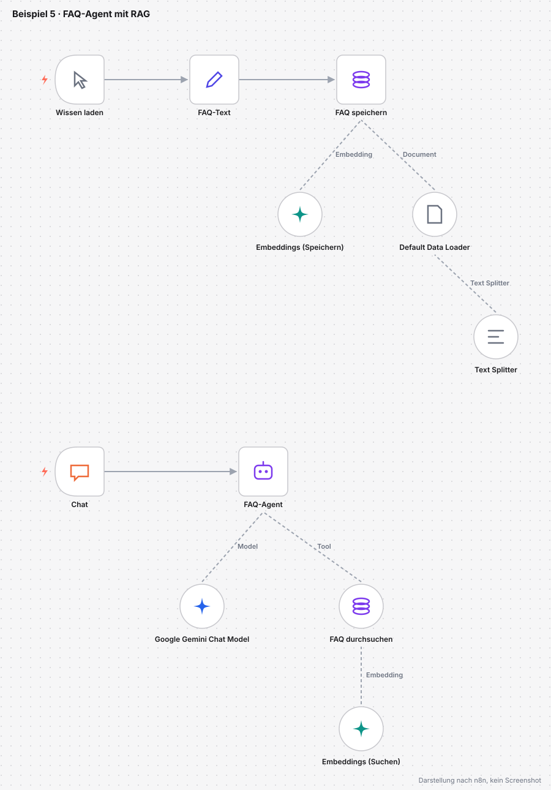
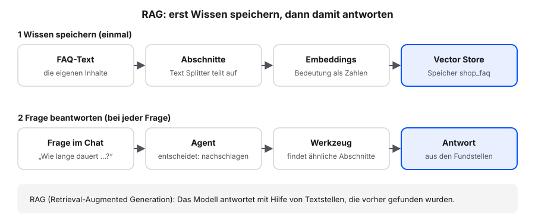
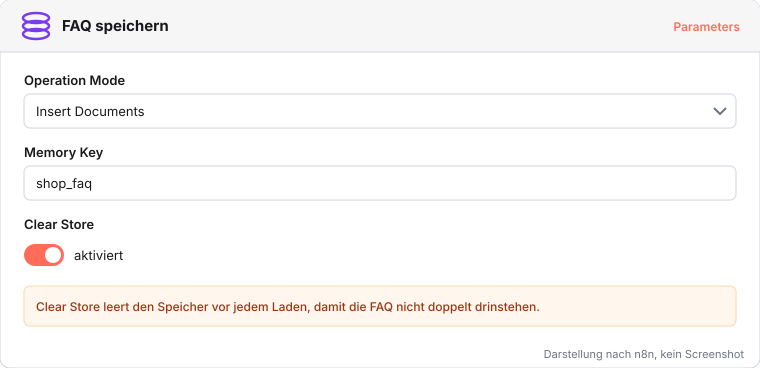
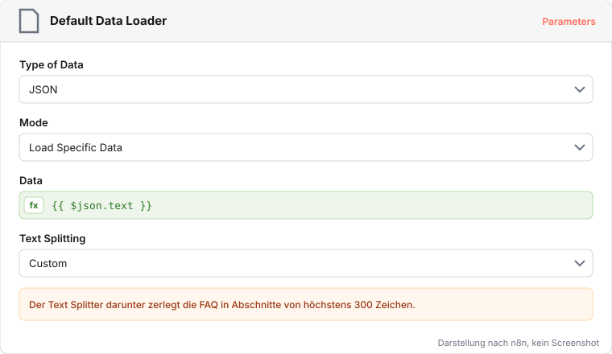
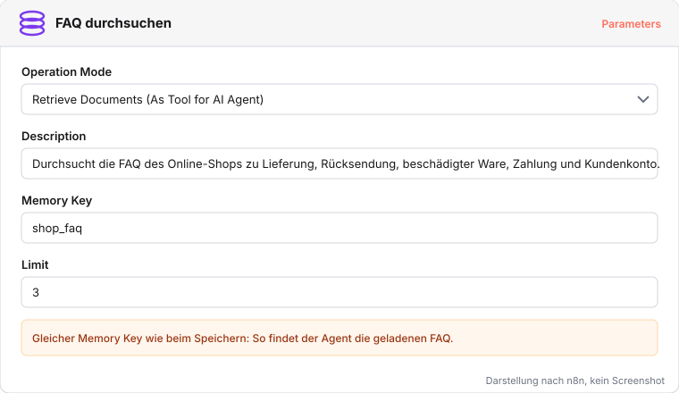
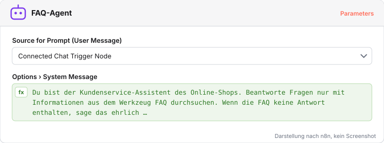

# Beispiel 5: FAQ-Agent mit RAG

Der Kundenservice beantwortet immer wieder dieselben Fragen zu Lieferung, Rücksendung und Zahlung. Ein Agent soll diese Fragen im Chat beantworten, aber nur mit dem, was in den FAQ des Shops steht. Dafür bekommt er ein Werkzeug, mit dem er in den FAQ nachschlägt. Dieses Vorgehen heißt RAG (Retrieval-Augmented Generation): Das Modell antwortet mit Hilfe von Textstellen, die vorher gefunden wurden.

Datei: [beispiel-5-faq-agent-rag.json](../workflows/beispiele/beispiel-5-faq-agent-rag.json)

## Wie RAG funktioniert

- **Embedding**: Ein Modell wandelt jeden Textabschnitt in eine Zahlenfolge um, die seine Bedeutung abbildet. Ähnliche Bedeutung ergibt ähnliche Zahlen.
- **Vector Store**: ein Speicher für diese Zahlenfolgen. Er findet zu einer Frage die Abschnitte mit der ähnlichsten Bedeutung.
- **Agent mit Werkzeug**: Der Agent entscheidet selbst, wann er nachschlägt, und formuliert die Antwort aus den Fundstellen.

## Hochladen, Wissen laden, fragen

Voraussetzung: das Gemini-Credential aus [Gemini-Schlüssel einrichten](gemini-schluessel.qmd).

1. Die Datei herunterladen und einen neuen Workflow öffnen.
2. Im Drei-Punkte-Menü **Import from File…** wählen und die Datei auswählen.
3. In den drei Gemini-Knoten (Google Gemini Chat Model, Embeddings (Speichern), Embeddings (Suchen)) jeweils das eigene Gemini-Credential wählen.
4. Im Knoten **Wissen laden** auf **Execute workflow** klicken. Die FAQ werden gespeichert.
5. Unten auf **Open chat** klicken und fragen: `Wie lange dauert die Lieferung und was kostet der Versand?`
6. Eine Frage stellen, die die FAQ nicht beantworten: `Kann ich in Raten zahlen?`

**Prüfen:** Die erste Antwort nennt 2 bis 4 Werktage und die Versandkosten. Bei der zweiten Frage sagt der Agent, dass die FAQ dazu nichts enthalten.

Der Simple Vector Store hält die FAQ nur im Arbeitsspeicher. Nach einem Neustart von n8n führen wir **Wissen laden** erneut aus.

## Teil 1: Wissen speichern

**FAQ speichern** legt die Abschnitte im Simple Vector Store unter dem Schlüssel `shop_faq` ab; Clear Store leert ihn vorher, damit nichts doppelt gespeichert wird. Der Data Loader nimmt den FAQ-Text, der Text Splitter teilt ihn in Abschnitte von höchstens 300 Zeichen. Kleine Abschnitte machen die Suche genauer.

## Teil 2: Agent und Werkzeug

**FAQ durchsuchen** ist derselbe Speicher, diesmal als Werkzeug für den Agenten. Die Beschreibung sagt dem Agenten, wofür das Werkzeug taugt; Limit 3 liefert die drei passendsten Abschnitte. Die System Message des **FAQ-Agent** legt fest, dass er nur mit Informationen aus dem Werkzeug antwortet und offen sagt, wenn die FAQ nichts enthalten. So gibt er im Namen des Shops keine erfundenen Zusagen.

