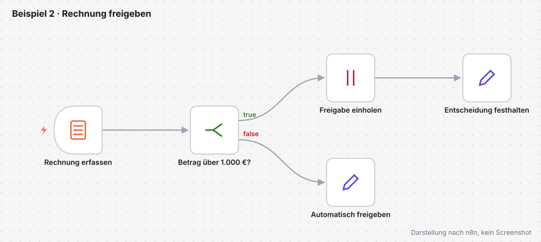
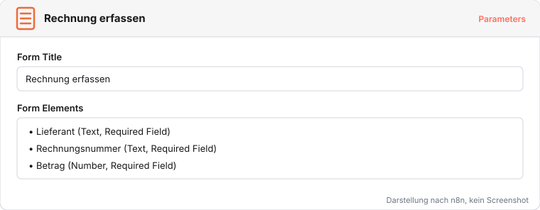
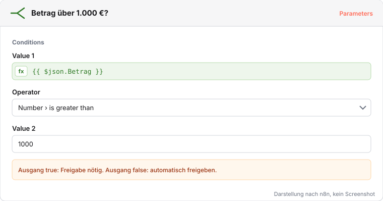
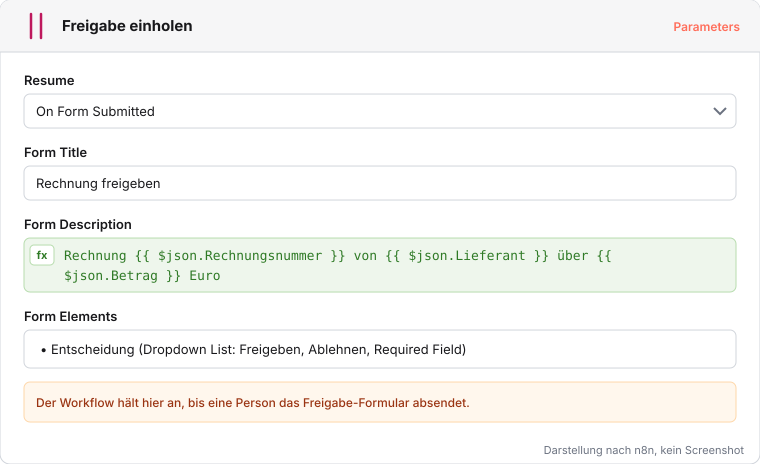
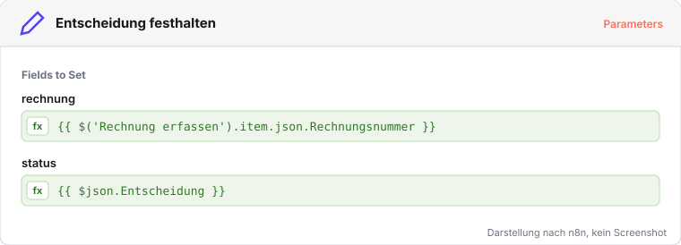

# Beispiel 2: Rechnung freigeben

Eingangsrechnungen bis 1.000 Euro gibt das Team ohne Rückfrage frei. Darüber entscheidet eine Person. Der Workflow erfasst die Rechnung, prüft den Betrag und hält bei großen Beträgen an, bis jemand im Freigabe-Formular entscheidet. Das ist die Benutzeraufgabe aus dem BPMN-Teil, umgesetzt mit dem Wait-Knoten.

Fertige Datei zum Vergleich: [beispiel-2-rechnung-freigeben.json](../workflows/beispiele/beispiel-2-rechnung-freigeben.json)

## Rechnung erfassen und Betrag prüfen

1. Neuer Workflow **Rechnung freigeben**, Trigger **On form submission** namens **Rechnung erfassen** mit den Pflichtfeldern `Lieferant`, `Rechnungsnummer` (Text) und `Betrag` (Number).
2. If-Knoten **Betrag über 1.000 €?** mit `{{ $json.Betrag }}` und **Number › is greater than** `1000`.

## Freigabe einholen

1. Am Ausgang true einen **Wait**-Knoten namens **Freigabe einholen** anhängen, **Resume** auf **On Form Submitted**.
2. Form Title `Rechnung freigeben`, Form Description als Expression mit Rechnungsnummer, Lieferant und Betrag, ein Pflichtfeld `Entscheidung` (Dropdown List: `Freigeben`, `Ablehnen`).
3. Dahinter **Entscheidung festhalten** (Edit Fields): `rechnung` aus Rechnung erfassen, `status` aus dem Feld Entscheidung.
4. Am Ausgang false **Automatisch freigeben** (Edit Fields) mit `status` = `automatisch freigegeben`.

**Prüfen:** Eine Rechnung über 240 Euro endet in Automatisch freigeben. Eine Rechnung über 2.400 Euro wartet in Freigabe einholen, bis das Freigabe-Formular abgeschickt ist.
