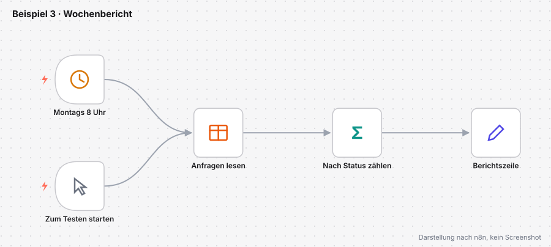
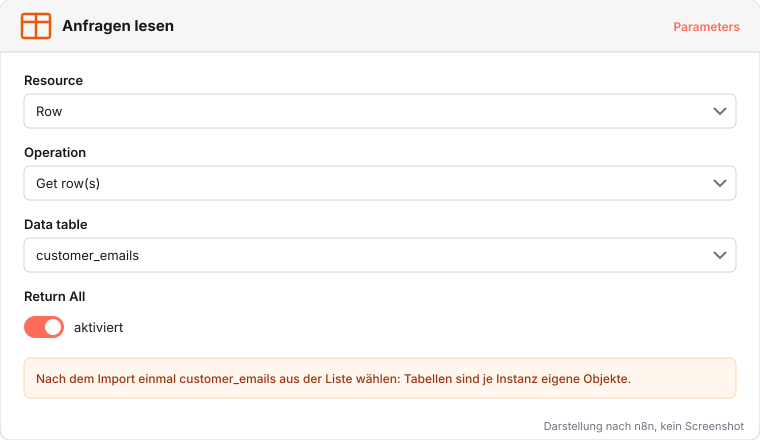
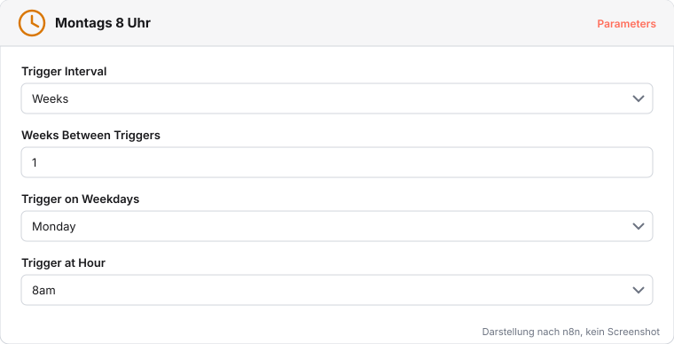
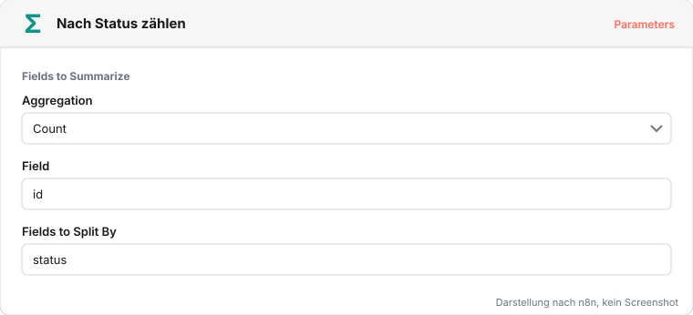

# Beispiel 3: Wochenbericht

Montags will die Teamleitung wissen, wie viele Anfragen in welchem Status sind. Ein Workflow liest dazu jeden Montag um 8 Uhr die Tabelle `customer_emails` aus dem ersten Workflow und zählt nach Status. Diesen Workflow laden wir als fertige Datei hoch.

Datei: [beispiel-3-wochenbericht.json](../workflows/beispiele/beispiel-3-wochenbericht.json)

## Hochladen und Tabelle zuordnen

1. Datei herunterladen, neuen Workflow öffnen, im Drei-Punkte-Menü **Import from File…** wählen.
2. Im Knoten **Anfragen lesen** bei **Data table** die Tabelle `customer_emails` wählen. Tabellen gehören zur jeweiligen Instanz und sind deshalb nicht Teil der Datei.
3. Mit **Execute workflow** über den Auslöser **Zum Testen starten** einen Lauf starten.

## Die Knoten

Der **Schedule Trigger** startet den Workflow nach Zeitplan, hier jeden Montag um 8 Uhr, sobald der Workflow aktiv ist. Der zweite Auslöser **Zum Testen starten** erlaubt einen Lauf per Klick. **Anfragen lesen** holt mit *Get row(s)* alle Zeilen, **Nach Status zählen** (Summarize) zählt sie je Wert im Feld `status`, **Berichtszeile** formuliert daraus je Status einen Satz.

