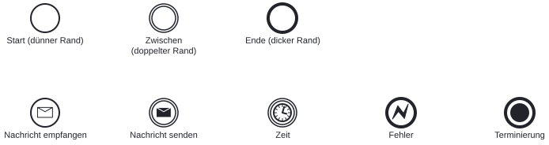
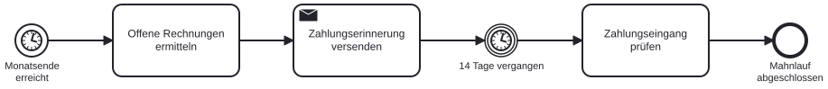
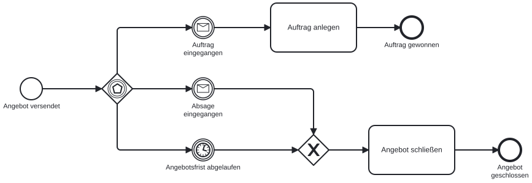

# Ereignisse: warten, reagieren, abbrechen

Bisher lief jeder Ablauf, sobald er gestartet war, ohne Pause bis zum Ende. Echte Abläufe warten: auf eine Antwort des Kunden, auf das Monatsende, auf eine Frist. Und sie reagieren auf Dinge, die während einer Aufgabe passieren, etwa eine Rückfrage oder einen abgelaufenen Termin. BPMN bildet all das mit **Ereignissen** ab, Kreisen mit einem Symbol in der Mitte. In diesem Kapitel lernen wir, wie Position und Symbol eines Ereignisses zusammenwirken, und bauen damit Wartesituationen, die ein n8n-Workflow später mit Wait-Knoten (Bausteinen, die den Ablauf anhalten) und Triggern abbilden muss.

## Der Rand sagt wo, das Symbol sagt was

Jedes Ereignis trägt zwei Informationen. Der **Rand** zeigt die Position im Prozess, das **Symbol** zeigt den Auslöser.

{#fig-ereignisse-legende width="90%"}

| Position | Rand | Bedeutung |
|---|---|---|
| **Start** | dünn | Löst den Prozess aus. |
| **Zwischen** | doppelt | Tritt während des Prozesses ein; der Prozess wartet darauf oder löst es selbst aus. |
| **Ende** | dick | Schließt einen Pfad oder den ganzen Prozess ab. |

| Auslöser | Symbol | Bedeutung |
|---|---|---|
| **Nachricht** | Briefumschlag | Hell: Eine Nachricht wird empfangen. Dunkel: Eine Nachricht wird gesendet. |
| **Zeit** | Uhr | Ein Termin, eine Frist oder eine Dauer. |
| **Fehler** | Blitz | Ein fachlicher Abbruch, der behandelt wird, etwa „Zahlung fehlgeschlagen“. |
| **Terminierung** | Gefüllter Kreis | Beendet sofort den ganzen Prozess, auch laufende parallele Pfade. |

Beide Informationen kombinieren sich frei. Ein dünner Kreis mit Uhr ist ein Zeit-Startereignis („jeden Montag um 8 Uhr“). Ein doppelter Kreis mit hellem Umschlag ist ein Nachrichten-Zwischenereignis („auf Antwort des Kunden warten“). Ein dicker Kreis mit dunklem Umschlag ist ein Nachrichten-Endereignis („Bestätigung versendet, Prozess zu Ende“).

::: {.callout-note title="Fehler und Terminierung kommen selten vor"}
In fachlichen Modellen reichen Nachricht und Zeit für die meisten Fälle. Fehlerereignisse brauchen wir, wenn ein Schritt fachlich scheitern kann und der Prozess darauf eine eigene Antwort hat. Terminierung brauchen wir, wenn ein Ergebnis alle noch laufenden parallelen Pfade sofort beenden soll, etwa die Rücknahme eines Antrags. Im n8n-Workflow entspricht der Fehlerfall einem Error-Trigger oder dem Fehlerausgang eines Knotens.
:::

## Zeitereignisse: starten und warten

Ein Zeitereignis am Start lässt den Prozess zu einem Zeitpunkt beginnen. Ein Zeitereignis dazwischen hält den Prozess an, bis die Zeit verstrichen ist.

{#fig-zeitereignisse width="100%"}

Drei Elemente sind hier neu:

- Das **Zeit-Startereignis** „Monatsende erreicht“: Der Prozess beginnt zu einem Zeitpunkt, nicht durch eine eingehende Nachricht. In n8n ist das ein Schedule Trigger, der den Workflow nach Zeitplan startet.
- Das **Zeit-Zwischenereignis** „14 Tage vergangen“: Der Prozess hält an und wartet, bis die Frist verstrichen ist. In n8n ist das ein Wait-Knoten.
- Die **Sendeaufgabe** „Zahlungserinnerung versenden“: Der dunkle Umschlag oben links zeigt, dass diese Aufgabe eine Nachricht verschickt. Die Aufgabentypen lernen wir im nächsten Kapitel vollständig kennen.

Was ist unrealistisch an diesem Modell? Es nimmt an, dass alle Kunden bis zum Ende der 14 Tage brauchen. Tatsächlich zahlen viele am zweiten Tag, und der Prozess wartet trotzdem die volle Frist ab, bevor er den Zahlungseingang prüft. Für „was zuerst eintritt“ gibt es ein eigenes Gateway.

## Ereignisbasiertes Gateway: was zuerst eintritt

Das ereignisbasierte Gateway trägt ein Fünfeck im doppelten Kreis. Es verzweigt nicht nach Daten, sondern nach Ereignissen: Hinter dem Gateway stehen nur Zwischenereignisse, und der Prozess wartet an dieser Stelle. Das erste Ereignis, das eintritt, bestimmt den Pfad. Die anderen verfallen.

{#fig-gateway-ereignisbasiert width="100%"}

Warum kann hier kein exklusives Gateway stehen? Ein XOR-Gateway entscheidet sofort, auf Grundlage von Daten, die zu diesem Zeitpunkt vorliegen. Direkt nach dem Versand liegt aber keine Antwort vor. Es gibt nichts zu entscheiden, sondern etwas abzuwarten. Genau diesen Unterschied drückt das ereignisbasierte Gateway aus. Im n8n-Workflow wird daraus ein Wait-Knoten mit einer Zeitgrenze, der entweder durch eine eingehende Antwort oder durch den Ablauf der Frist weiterläuft.

::: {.callout-tip title="Zwei Fragen für die Wahl des Gateways"}
Erstens: Liegt die Information, nach der verzweigt wird, zum Zeitpunkt des Gateways schon vor? Wenn ja, XOR. Wenn nein, ereignisbasiert. Zweitens: Was passiert, wenn gar nichts eintritt? Ein ereignisbasiertes Gateway ohne Zeit-Zwischenereignis wartet ewig. Fast immer gehört deshalb eine Frist dazu.
:::

## Randereignisse: Ereignisse während einer Aufgabe

Manchmal passiert etwas, während eine Aufgabe läuft. Dafür hängt BPMN ein Ereignis an den Rand der Aufgabe, ein **Randereignis** (Boundary Event). Zwei Varianten unterscheiden sich im Rand des Kreises:

{#fig-randereignisse width="100%"}

| Variante | Rand | Wirkung |
|---|---|---|
| **Unterbrechend** | durchgezogen | Die Aufgabe wird abgebrochen. Der Prozess folgt nur noch dem neuen Pfad. |
| **Nicht unterbrechend** | gestrichelt | Die Aufgabe läuft weiter. Zusätzlich startet ein paralleler Pfad. |

Im Beispiel wartet der Kundenservice auf Belege, die er nachgefordert hat. Läuft die Frist ab, hat das Warten keinen Sinn mehr: Das unterbrechende Zeit-Randereignis bricht die Aufgabe ab, der Vorgang wird geschlossen. Stellt der Kunde zwischendurch eine Rückfrage, soll das Warten nicht enden: Das nicht unterbrechende Nachrichten-Randereignis startet einen zusätzlichen Pfad, auf dem die Rückfrage beantwortet wird, und die Aufgabe wartet weiter.

Was fehlt im Modell, wenn die Rückfrage den Fall verändert, etwa weil der Kunde nach der Antwort doch keine Belege mehr schickt? Dann müsste der Pfad „Rückfrage beantworten“ in die Hauptaufgabe zurückwirken, etwa über eine Entscheidung „Belege noch nötig?“. Ein nicht unterbrechendes Randereignis eignet sich für Nebentätigkeiten, die den Hauptpfad nicht ändern: Erinnerungen, Zwischenstände, Rückfragen.

::: {.callout-important title="Die Wahl ist eine fachliche Entscheidung"}
Ob ein Randereignis unterbricht, entscheidet die Fachabteilung, nicht die Notation. „Nach 14 Tagen gilt der Antrag als zurückgezogen“ ist unterbrechend. „Nach drei Tagen erinnern wir die Fachabteilung, die Prüfung läuft weiter“ ist nicht unterbrechend. Wer das Modell liest, muss diese Regel am Rand des Kreises erkennen können. Deshalb lohnt es sich, die zugehörige Frist in einer Textanmerkung festzuhalten.
:::

## Arbeitsauftrag: eine Frist modellieren

**Zeitbedarf:** etwa 15 Minuten

**Voraussetzungen:**

- Browser mit Zugang zu [demo.bpmn.io](https://demo.bpmn.io/)

**Schritte:**

1. Ein neues Diagramm anlegen.
2. Ein Nachrichten-Startereignis „Bewerbung eingegangen“ anlegen (Startereignis anklicken, Schraubenschlüssel-Symbol, „Message Start Event“ wählen).
3. Eine Aufgabe „Einladung zum Gespräch versenden“ anhängen.
4. Ein ereignisbasiertes Gateway anhängen (Gateway anklicken, Schraubenschlüssel-Symbol, „Event based Gateway“ wählen).
5. Ein Nachrichten-Zwischenereignis „Zusage eingegangen“ anhängen.
6. Ein Zeit-Zwischenereignis „Frist von 7 Tagen abgelaufen“ als zweiten Ausgang anhängen.
7. Hinter der Zusage eine Aufgabe „Gespräch terminieren“ und ein Endereignis „Gespräch vereinbart“ anlegen.
8. Hinter der Frist eine Aufgabe „Nachfassen“ und ein Endereignis „Bewerbung nachgefasst“ anlegen.
9. Das Diagramm als BPMN-Datei herunterladen.

**Prüfen:** Das Modell ist fertig, wenn hinter dem ereignisbasierten Gateway ausschließlich Zwischenereignisse stehen, eines davon ein Zeitereignis ist und jeder Pfad in einem benannten Endereignis endet.

## Kontrollpunkt

- Position (Start, Zwischen, Ende) und Auslöser (Nachricht, Zeit, Fehler, Terminierung) eines Ereignisses am Symbol erkennen
- Zeit-Start- und Zeit-Zwischenereignis unterscheiden und den passenden n8n-Baustein nennen
- Begründen, wann ein ereignisbasiertes Gateway statt eines exklusiven Gateways nötig ist
- Unterbrechende und nicht unterbrechende Randereignisse am Rand erkennen und ihre Wirkung erklären
- Eine Wartesituation mit Frist in demo.bpmn.io modellieren
