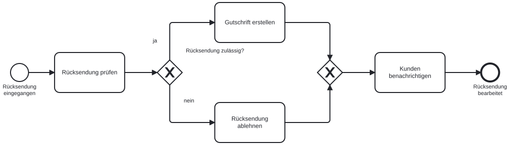
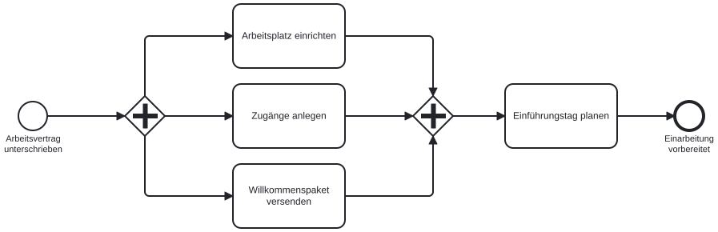

# Gateways: verzweigen und zusammenführen

Kaum ein Ablauf läuft gerade durch. Eine Rücksendung ist zulässig oder nicht, beim Onboarding passieren mehrere Dinge gleichzeitig, und bei einer Bestellung treffen manchmal zwei Sonderfälle zusammen. BPMN bildet solche Stellen mit **Gateways** ab, Rauten mit einem Symbol in der Mitte. Ein Gateway trifft keine Entscheidung und erledigt keine Arbeit. Es steuert nur, welche Pfade der Sequenzfluss nimmt. In diesem Kapitel lernen wir die drei Gateway-Typen kennen, die fast jedes fachliche Modell braucht.

## Exklusives Gateway (XOR): genau ein Weg

Das exklusive Gateway trägt ein X. Von den ausgehenden Pfaden wird genau einer gewählt, abhängig von Daten, die zu diesem Zeitpunkt bekannt sind.

{#fig-gateway-xor width="100%"}

Drei Dinge fallen auf. Die Frage steht am Gateway („Rücksendung zulässig?“), die Antworten stehen an den Kanten („ja“, „nein“). Die Prüfung selbst ist eine eigene Aufgabe vor dem Gateway („Rücksendung prüfen“); das Gateway wertet nur ihr Ergebnis aus. Und die Pfade treffen sich wieder in einem zweiten XOR-Gateway, bevor der gemeinsame Rest des Ablaufs folgt.

::: {.callout-tip title="Versteckte Entscheidungen aufdecken"}
„Rücksendung prüfen und gegebenenfalls ablehnen“ ist als eine Aufgabe falsch modelliert. Darin stecken eine Aufgabe (prüfen), eine Entscheidung (zulässig?) und eine zweite Aufgabe auf nur einem der Pfade (ablehnen). Wer das in einer Aufgabe zusammenfasst, versteckt die Entscheidung, und im späteren Workflow fehlt dann der IF-Knoten.
:::

Was wäre, wenn die Prüfung noch ein drittes Ergebnis haben kann, etwa „Rückfrage nötig“? Dann bekommt das Gateway eine dritte ausgehende Kante mit dieser Antwort und einen eigenen Pfad, der ebenfalls wieder zusammengeführt wird. Ein XOR-Gateway darf beliebig viele Ausgänge haben, solange genau einer gilt.

## Paralleles Gateway (AND): alle Wege zugleich

Das parallele Gateway trägt ein Plus. Alle ausgehenden Pfade starten ohne Bedingung. Das zusammenführende AND-Gateway wartet, bis alle Pfade angekommen sind, und lässt erst dann den Ablauf weiterlaufen.

{#fig-gateway-and width="100%"}

„Gleichzeitig“, „parallel“ und „in beliebiger Reihenfolge“ sind die Signalwörter für dieses Gateway. Wichtig ist das Wort „unabhängig“: Die drei Aufgaben brauchen das Ergebnis der anderen nicht. Hinge das Willkommenspaket von den angelegten Zugängen ab, gehörte es hinter „Zugänge anlegen“ in eine Reihe.

Was passiert, wenn rechts statt des AND-Gateways ein XOR-Gateway zusammenführt? Das XOR-Gateway wartet nicht. Der erste ankommende Pfad läuft sofort weiter, und der Einführungstag wird dreimal geplant, einmal pro Pfad. Dieser Fehler ist in der Praxis häufig, weil beide Rauten auf den ersten Blick ähnlich aussehen.

## Inklusives Gateway (OR): einer oder mehrere Wege

Das inklusive Gateway trägt einen Kreis. Jeder Pfad, dessen Bedingung zutrifft, startet. Das können einer, mehrere oder alle sein. Der **Standardfluss**, erkennbar am kleinen Querstrich an der Kante, greift nur, wenn keine Bedingung zutrifft.

{#fig-gateway-or width="100%"}

Welche Pfade laufen bei einem Neukunden mit Lieferadresse im Ausland? Beide: Bonität prüfen und Zollunterlagen vorbereiten. Das zusammenführende OR-Gateway weiß, dass zwei Pfade gestartet wurden, und wartet auf beide, bevor die Bestellung freigegeben wird. Bei einem Bestandskunden im Inland läuft nur der Standardfluss, und das Gateway wartet auf nichts.

::: {.callout-note title="OR ist seltener, als es scheint"}
Viele Modellierende greifen zum inklusiven Gateway, wenn sie unsicher sind. Die Faustregel lautet umgekehrt: Zuerst prüfen, ob die Bedingungen sich gegenseitig ausschließen (dann XOR) oder ob ohnehin immer alle Pfade laufen (dann AND). Nur wenn wirklich „einer oder mehrere, je nach Fall“ gemeint ist, passt OR. Im späteren n8n-Workflow wird aus einem OR meist eine Kette von IF-Knoten, die unabhängig voneinander prüfen.
:::

## Drei Gateways im Vergleich

| | Exklusiv (XOR) | Parallel (AND) | Inklusiv (OR) |
|---|---|---|---|
| **Symbol** | X | Plus | Kreis |
| **Verzweigt** | genau ein Pfad, abhängig von Daten | alle Pfade, ohne Bedingung | jeder Pfad, dessen Bedingung zutrifft |
| **Führt zusammen** | lässt jeden ankommenden Pfad sofort durch | wartet, bis alle Pfade angekommen sind | wartet auf alle tatsächlich gestarteten Pfade |
| **Signalwörter** | entweder, oder, falls, je nachdem | gleichzeitig, parallel, in beliebiger Reihenfolge | mindestens eines, gegebenenfalls beides |

::: {.callout-important title="Faustregel: Zusammenführen mit dem Typ, mit dem verzweigt wurde"}
Ein XOR-Split bekommt einen XOR-Join, ein AND-Split einen AND-Join, ein OR-Split einen OR-Join. Gemischte Paare sind fast immer ein Fehler: Ein XOR-Join nach einem AND-Split lässt die Folgeschritte mehrfach laufen, ein AND-Join nach einem XOR-Split wartet auf Pfade, die nie kommen, und der Prozess bleibt stehen.
:::

## Welches Gateway passt?

Drei kurze Fälle. Für jeden überlegen wir, welches Gateway verzweigt, bevor wir die Auflösung lesen.

**A.** Nach der Prüfung wird eine Rechnung entweder zur Zahlung freigegeben oder an den Lieferanten zurückgewiesen.

**B.** Vor dem Austritt einer Mitarbeiterin bestätigen IT, Facility-Management und Personalabteilung die Rückgabe von Laptop, Schlüssel und Firmenwagen, in beliebiger Reihenfolge.

**C.** Für eine Messeteilnahme werden je nach Standort Reisemittel beantragt, eine Sicherheitsunterweisung organisiert oder beides.

::: {.callout-note title="Auflösung" collapse="true"}
**A** ist exklusiv (XOR): „entweder, oder“, genau ein Ergebnis. **B** ist parallel (AND): drei unabhängige Bestätigungen, alle müssen vorliegen, die Reihenfolge ist egal. **C** ist inklusiv (OR): „oder beides“ bedeutet einer oder mehrere Pfade je nach Fall. Wer bei C zum XOR greift, kann den Fall „beides“ nicht abbilden; wer zum AND greift, organisiert eine Sicherheitsunterweisung auch dort, wo keine nötig ist.
:::

## Arbeitsauftrag: eine Entscheidung modellieren

**Zeitbedarf:** etwa 10 Minuten

**Voraussetzungen:**

- Das Modell „Rechnung prüfen“ aus dem vorigen Kapitel in demo.bpmn.io geöffnet

**Schritte:**

1. Zwischen „Rechnung prüfen“ und „Rechnung zur Zahlung freigeben“ ein exklusives Gateway einfügen.
2. Das Gateway mit der Frage „Rechnung korrekt?“ beschriften.
3. Die Kante zur Freigabe mit „ja“ beschriften.
4. Vom Gateway eine zweite Kante zu einer neuen Aufgabe „Rechnung zurückweisen“ ziehen.
5. Diese Kante mit „nein“ beschriften.
6. An „Rechnung zurückweisen“ ein eigenes Endereignis „Rechnung zurückgewiesen“ anhängen.
7. Das Diagramm als BPMN-Datei herunterladen.

**Prüfen:** Das Modell ist fertig, wenn das Gateway eine Frage trägt, jede ausgehende Kante eine Antwort trägt und jeder Pfad in einem benannten Endereignis endet. Eine Zusammenführung ist hier nicht nötig, weil die Pfade in verschiedenen Enden auslaufen.

## Kontrollpunkt

- XOR, AND und OR am Symbol erkennen und ihre Verzweigungsregel nennen
- Erklären, worauf das zusammenführende Gateway jedes Typs wartet
- Eine versteckte Entscheidung in einer Aufgabe erkennen und in Aufgabe, Gateway und Pfad auflösen
- Den Standardfluss eines inklusiven Gateways erkennen und begründen
- Für eine Prozessbeschreibung anhand der Signalwörter den passenden Gateway-Typ wählen
