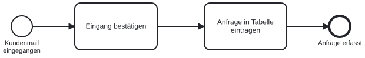

# Grundelemente und gute Namen

Ein n8n-Workflow beginnt nicht im Editor, sondern mit einer Frage: Was passiert eigentlich genau, wenn eine Kundenmail eingeht? Wer die Antwort nur im Kopf hat, baut später Knoten, verschiebt sie wieder und merkt beim Testen, dass ein Fall fehlt. Wer den Ablauf vorher zeichnet, sieht die Lücken, bevor sie Arbeit kosten. In diesem Kapitel lernen wir die Notation dafür kennen, lesen ein erstes Modell und üben, Elemente so zu benennen, dass andere das Modell ohne Erklärung verstehen.

## Warum BPMN?

BPMN steht für Business Process Model and Notation. Drei Eigenschaften machen die Notation für uns interessant:

| Eigenschaft | Was das für uns bedeutet |
|---|---|
| **Standardisiert** | Gepflegt von der Object Management Group (OMG). Version 2.0 gibt es seit 2011, sie ist auch als ISO/IEC 19510 genormt [@omgBpmn20; @isoBpmn19510]. Ein BPMN-Modell liest sich in jedem Unternehmen gleich. |
| **Verständlich** | Eine überschaubare Grundnotation reicht für die meisten fachlichen Modelle. Details kommen nur bei Bedarf hinzu. |
| **Ausführbar** | Prozess-Engines wie Camunda führen BPMN-Modelle direkt aus. Das Fachmodell wird damit zur Grundlage der Automatisierung. |

n8n liest kein BPMN. Wir übertragen das Modell am Ende dieses Teils von Hand in Knoten. Der Gewinn liegt davor: Das Modell klärt Auslöser, Entscheidungen, Zuständigkeiten und Wartesituationen, bevor wir den ersten Knoten ziehen.

::: {.callout-tip title="Das Modell als Grundriss"}
Ein BPMN-Modell ist für einen Ablauf, was ein Grundriss für eine Wohnung ist. Niemand zeichnet darin jede Steckdose, aber jede Tür und jede Wand steht an der richtigen Stelle. Wer den Grundriss liest, weiß, wie wir von der Küche ins Bad kommen. Wer unser Modell liest, weiß, wer wann was tut und wo entschieden wird.
:::

## Vier Gruppen von Elementen

Die Spezifikation kennt sehr viele Symbole. Alle lassen sich auf vier Gruppen zurückführen, und diese vier Gruppen strukturieren auch die folgenden Kapitel:

| Gruppe | Elemente | Frage, die sie beantworten |
|---|---|---|
| **Flussobjekte** | Ereignis, Aktivität, Gateway | Was passiert, und in welcher Reihenfolge? |
| **Verbindungen** | Sequenzfluss, Nachrichtenfluss, Assoziation | Was folgt worauf, wer spricht mit wem? |
| **Teilnehmer** | Pool, Lane | Wer ist zuständig? |
| **Daten und Artefakte** | Datenobjekt, Datenspeicher, Textanmerkung | Welche Informationen werden gebraucht oder erzeugt? |

In diesem Kapitel bleiben wir bei den Flussobjekten und dem Sequenzfluss. Gateways folgen im nächsten Kapitel, Ereignisse, Teilnehmer und Daten danach.

## Start, Aufgaben, Ende

Das kleinste sinnvolle Modell besteht aus vier Elementen. Wir lesen es von links nach rechts entlang der Pfeile.

{#fig-grundelemente width="85%"}

| Element | Symbol | Bedeutung |
|---|---|---|
| **Startereignis** | Dünner Kreis | Löst den Prozess aus. Benannt als eingetretener Zustand: „Kundenmail eingegangen“. |
| **Aufgabe** | Rechteck mit abgerundeten Ecken | Ein Arbeitsschritt, den eine Person oder ein System ausführt. |
| **Sequenzfluss** | Durchgezogener Pfeil | Legt die Reihenfolge der Schritte innerhalb eines Prozesses fest. |
| **Endereignis** | Dicker Kreis | Markiert ein Ergebnis. Ein Prozess darf mehrere Enden haben, etwa „Anfrage erfasst“ und „Anfrage abgelehnt“. |

Genau dieses Modell bauen wir im Teil „Erste Workflows“ als n8n-Workflow: Das Startereignis wird zum Trigger, jede Aufgabe zu einem Knoten, der Sequenzfluss zur Verbindung zwischen den Knoten. Die Notation gibt uns also schon hier die Struktur des späteren Workflows vor.

::: {.callout-note title="Aufgabe oder Aktivität?"}
BPMN spricht von **Aktivitäten** als Oberbegriff. Eine **Aufgabe** (Task) ist die kleinste Aktivität, ein einzelner Arbeitsschritt. Ein **Teilprozess** ist eine Aktivität, die selbst wieder aus Schritten besteht. Im Alltag sagen wir fast immer „Aufgabe“; Teilprozesse lernen wir im Kapitel über Teilnehmer und Daten kennen.
:::

## Gute Namen

Ein Modell ist nur so verständlich wie seine Beschriftungen. Vier Regeln machen den Unterschied zwischen einem Bild, das jemand erklären muss, und einem Bild, das sich selbst erklärt:

| Element | Regel | Gut | Ungünstig |
|---|---|---|---|
| Aufgabe | Objekt + Verb im Infinitiv | Anfrage prüfen | Prüfung |
| Ereignis | Objekt + Partizip (Zustand) | Anfrage eingegangen | Eingang |
| XOR-Gateway | Frage; die ausgehenden Kanten tragen die Antworten | Anfrage vollständig? | Vollständigkeit |
| Lane | Rolle oder Stelle, keine Person | Kundenservice | Frau Müller |

Zur Erinnerung: Der **Infinitiv** ist die Grundform eines Verbs („prüfen“, „bestätigen“). Das **Partizip** beschreibt etwas Abgeschlossenes („eingegangen“, „geprüft“).

Die Regel für Aufgaben hat einen praktischen Nebeneffekt: Wer „Prüfung“ schreibt, kann die Prüfung von „Anfrage prüfen“, „Belege prüfen“ und „Bonität prüfen“ nicht mehr unterscheiden. Wer das Objekt nennt, sieht sofort, worauf der Schritt arbeitet. Sammelverben wie „bearbeiten“ oder „verarbeiten“ sagen nichts; sie verstecken meist mehrere Schritte oder eine Entscheidung. Eine Faustregel hilft: Lässt sich am Namen ablesen, wann die Aufgabe fertig ist, ist das Verb konkret genug. Nach „Rechnung prüfen“ steht fest, ob die Rechnung in Ordnung ist; nach „Rechnung bearbeiten“ bleibt offen, was passiert ist.

::: {.callout-important title="Keine Abkürzungen, keine Systemkürzel"}
„Anfrage ins CRM“ versteht die Kollegin aus dem Vertrieb. „Lead in SFDC pushen“ versteht nur, wer das System kennt. Ein Modell, das Fachbereich und IT gemeinsam lesen sollen, verwendet die Begriffe, die beide Seiten teilen. Systemnamen gehören in die Beschreibung einer Aufgabe oder in einen Datenspeicher, nicht in den Aufgabennamen.
:::

## Eine Beschreibung übersetzen

Mit den vier Grundelementen und den Benennungsregeln lesen wir einen Satz aus einer typischen Prozessbeschreibung:

> „Der Kundenservice kontrolliert die Unterlagen und schickt sie gegebenenfalls zurück.“

Der Satz enthält mehr, als er zeigt. „Kontrolliert“ ist eine Aufgabe: *Unterlagen prüfen*. „Gegebenenfalls“ versteckt eine Entscheidung mit einer Frage: *Unterlagen vollständig?* Und „schickt zurück“ ist ein zweiter Schritt, der nur auf einem der beiden Wege liegt: *Unterlagen zurücksenden*. Aus einem Satz werden also eine Aufgabe, eine Entscheidung und eine weitere Aufgabe, plus zwei mögliche Enden. Wie wir die Entscheidung zeichnen, ist Thema des nächsten Kapitels; wichtig ist hier die Lesetechnik: Jedes Verb wird zu einer Aufgabe, jedes „wenn“, „falls“ oder „gegebenenfalls“ zu einer Frage, jedes mögliche Ergebnis zu einem Ende.

::: {.callout-tip title="Signalwörter in Prozessbeschreibungen"}
Beim Lesen einer Beschreibung markieren wir drei Arten von Wörtern. **Verben** („prüft“, „versendet“, „verbucht“) werden zu Aufgaben. **Bedingungen** („wenn“, „falls“, „gegebenenfalls“, „andernfalls“) werden zu Fragen an einem Gateway. **Zeit- und Ereigniswörter** („sobald“, „nach vier Wochen“, „gleichzeitig“) werden zu Ereignissen oder bestimmen den Gateway-Typ. Diese Markierung ist der erste Schritt jeder Modellierung, auch wenn später ein Sprachmodell den Entwurf zeichnet.
:::

## Arbeitsauftrag: ein erstes Modell zeichnen

**Zeitbedarf:** etwa 10 Minuten

**Voraussetzungen:**

- Browser mit Zugang zu [demo.bpmn.io](https://demo.bpmn.io/)

**Schritte:**

1. demo.bpmn.io öffnen.
2. Über das Plus-Symbol unten links ein neues Diagramm anlegen.
3. Das Startereignis anklicken und über Doppelklick mit „Rechnung eingegangen“ beschriften.
4. Über das Menü neben dem Startereignis eine Aufgabe anhängen.
5. Die Aufgabe mit „Rechnung prüfen“ beschriften.
6. Eine zweite Aufgabe „Rechnung zur Zahlung freigeben“ anhängen.
7. Ein Endereignis anhängen und mit „Rechnung freigegeben“ beschriften.
8. Das Diagramm über die Schaltflächen unten links als BPMN-Datei herunterladen.

**Prüfen:** Das Modell ist fertig, wenn jede Aufgabe ein Objekt und ein Verb im Infinitiv trägt, beide Ereignisse einen Zustand benennen und ein durchgehender Sequenzfluss vom Start bis zum Ende führt.

## Kontrollpunkt

- Die drei Eigenschaften von BPMN nennen, die es für Fachbereich und IT zur gemeinsamen Sprache machen
- Die vier Elementgruppen unterscheiden
- Start, Aufgabe, Sequenzfluss und Ende in einem Modell erkennen und selbst zeichnen
- Aufgaben, Ereignisse, Gateways und Lanes nach den vier Benennungsregeln beschriften
- In einer Prozessbeschreibung Verben, Bedingungen und Zeitwörter markieren
