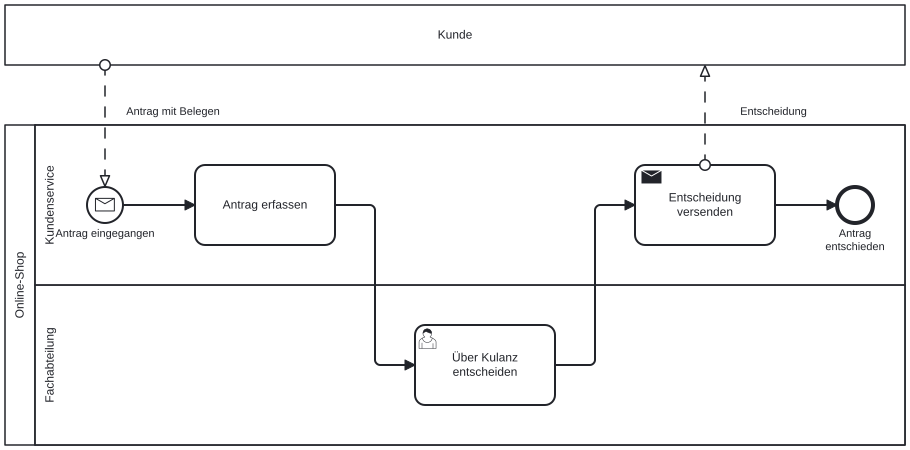
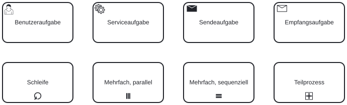
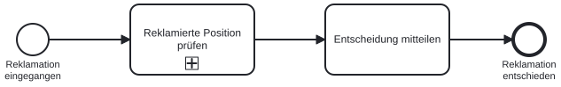
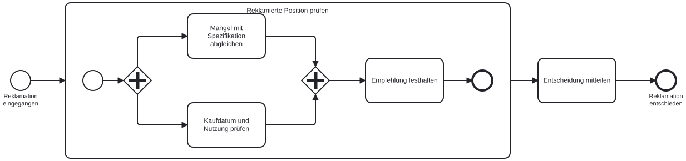
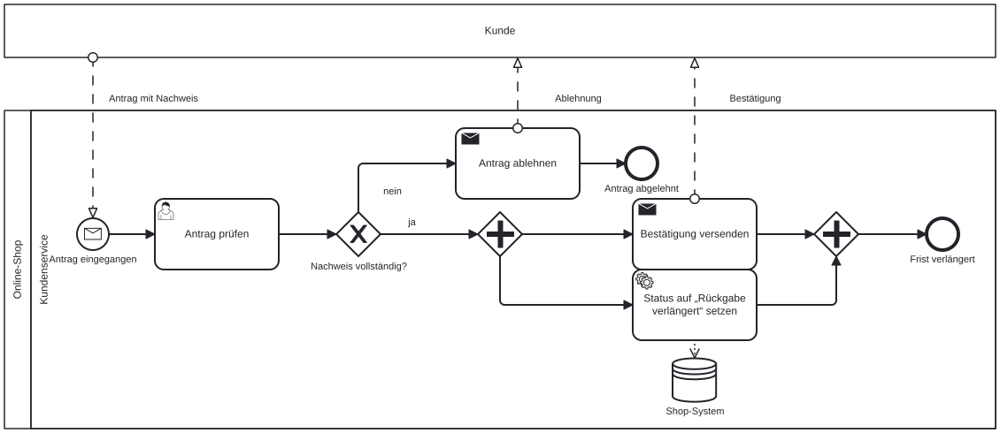

# Teilnehmer, Daten und Aufgabentypen

Dieses Kapitel ergänzt die beiden letzten Elementgruppen: Teilnehmer (Pools und Lanes) sowie Daten und Artefakte. Damit zeigt ein Modell, wer einen Schritt ausführt und welche Informationen dabei fließen.

Als Beispiel dient ein Kulanzantrag. Der Kunde reicht ihn ein, der Kundenservice erfasst ihn, und die Fachabteilung entscheidet.

Außerdem lernen wir die Aufgabentypen und Marker kennen. Sie zeigen, ob ein Mensch oder ein System einen Schritt erledigt, und sind deshalb für den späteren n8n-Workflow wichtig.

## Pools, Lanes und Nachrichtenflüsse

Ein **Pool** ist ein eigenständiger Teilnehmer mit eigenem Prozess, etwa unser Online-Shop oder der Kunde. Eine **Lane** ist eine Rolle oder Stelle innerhalb eines Pools und zeigt, wer eine Aufgabe ausführt. Zwischen Pools gibt es keinen Sequenzfluss, sondern nur **Nachrichtenflüsse**, gestrichelte Linien mit einem kleinen Kreis am Anfang und einer hellen Pfeilspitze am Ende.

{#fig-pools-lanes width="100%"}

| Element | Bedeutung |
|---|---|
| **Pool** | Eigenständiger Teilnehmer mit eigenem Prozess. **Zugeklappt** (ohne Inhalt) zeigt er nur, dass es den Teilnehmer gibt: eine Black Box. Wir wissen nicht, was der Kunde intern tut, nur was er uns schickt. |
| **Lane** | Rolle oder Stelle innerhalb eines Pools: „Kundenservice“, „Fachabteilung“. Eine Übergabe zwischen Lanes ist ein normaler Sequenzfluss. |
| **Nachrichtenfluss** | Gestrichelt, nur zwischen Pools. Trägt den Namen der Nachricht: „Antrag mit Belegen“, „Entscheidung“. |

Der Nachrichtenfluss darf an einem Pool-Rand enden oder beginnen (beim zugeklappten Kunden) oder an einem Element im Pool (beim Nachrichten-Startereignis und bei der Sendeaufgabe im Online-Shop). Welche Nachricht welchen Schritt auslöst, wird damit auf einen Blick sichtbar.

::: {.callout-note title="Lane oder Pool?"}
Für die Wahl zählt, ob ein Beteiligter im selben Prozess mitarbeitet oder einen eigenen Prozess führt und nur über Nachrichten kommuniziert.

- Kundenservice und Fachabteilung arbeiten am selben Antrag, folgen derselben Reihenfolge und sehen dieselben Daten. Sie sind Lanes.
- Der Kunde entscheidet selbst, wann er Belege schickt, und wir sehen seine Schritte nicht. Er ist ein eigener Pool.

Dieselbe Regel gilt für externe Dienstleister, Behörden oder Lieferanten.
:::

## Daten und Anmerkungen

Aufgaben erzeugen und brauchen Informationen. BPMN zeigt das mit zwei Datenelementen und einer Anmerkung, alle über gepunktete **Assoziationen** mit dem Ablauf verbunden.

{#fig-daten width="100%"}

| Element | Symbol | Bedeutung |
|---|---|---|
| **Datenobjekt** | Blatt mit Eselsohr | Information, die im Prozess entsteht oder gebraucht wird und nur für diesen Durchlauf gilt: eine Anfrage, ein Bescheid, ein Prüfformular. |
| **Datenspeicher** | Zylinder | Dauerhafte Ablage über die Prozessinstanz hinaus: eine Tabelle, ein CRM, eine Kundenakte. |
| **Textanmerkung** | Offene Klammer mit Text | Ergänzender Hinweis, etwa eine Regel oder eine Frist. Die gepunktete Linie steuert keinen Ablauf. |

Die Pfeilrichtung der Assoziation zeigt, ob eine Aufgabe das Datenobjekt erzeugt (Pfeil zum Objekt) oder verwendet (Pfeil zur Aufgabe). Der Datenspeicher „Tabelle customer_emails“ ist genau die Data Table, die unser Workflow im Teil „Erste Workflows“ beschreibt. Systemnamen gehören hierhin, nicht in den Aufgabennamen.

## Aufgabentypen und Marker

Bisher haben wir nur neutrale Aufgaben gezeichnet. Ein kleines Symbol oben links legt den **Typ** fest, also wer oder was den Schritt erledigt. Ein Symbol unten in der Mitte ist ein **Marker** und sagt, wie oft der Schritt läuft.

{#fig-aufgabentypen width="90%"}

| Typ | Symbol | Bedeutung | Später in n8n |
|---|---|---|---|
| **Benutzeraufgabe** | Person | Ein Mensch arbeitet mit IT-Unterstützung: prüfen, entscheiden, freigeben. | Formular oder Freigabe, auf die der Workflow wartet |
| **Serviceaufgabe** | Zahnräder | Ein System erledigt den Schritt automatisch: eintragen, abrufen, berechnen. | Ein Knoten |
| **Sendeaufgabe** | Dunkler Umschlag | Verschickt eine Nachricht an einen anderen Pool. | Send-Email- oder Chat-Knoten |
| **Empfangsaufgabe** | Heller Umschlag | Wartet auf eine Nachricht von außen. | Wait-Knoten oder Trigger |

| Marker | Symbol | Bedeutung |
|---|---|---|
| **Schleife** | Pfeil im Kreis | Wiederholen, bis eine Bedingung erfüllt ist: „Entwurf überarbeiten, bis freigegeben“. |
| **Mehrfach, parallel** | Drei senkrechte Striche | Je Element einer Liste einmal, gleichzeitig: „je reklamierter Position prüfen“. |
| **Mehrfach, sequenziell** | Drei waagerechte Striche | Je Element einer Liste einmal, nacheinander: wenn jede Prüfung auf dem Ergebnis der vorigen aufbaut. |
| **Teilprozess** | Plus im Kästchen | Fasst mehrere Schritte zusammen. |

::: {.callout-tip title="Der Typ ist die wichtigste Angabe für den Workflow"}
Für die Übertragung nach n8n ist der Aufgabentyp die wichtigste Angabe. Serviceaufgaben werden zu Knoten, die von allein laufen. Benutzeraufgaben sind die Stellen, an denen der Workflow anhält und einen Menschen fragt. Ein Modell mit typisierten Aufgaben zeigt also bereits, was automatisiert wird und was beim Menschen bleibt. Im Demo-Szenario des Kurses sind Bestätigen und Eintragen Serviceaufgaben, die Kulanzfreigabe ist eine Benutzeraufgabe.
:::

## Teilprozesse: Details ein- und ausblenden

Ein Teilprozess fasst mehrere Schritte zu einer Aktivität zusammen. Zugeklappt zeigt er nur seinen Namen und den Plus-Marker; aufgeklappt zeigt er die Schritte mit eigenem Start und eigenem Ende im Inneren.

{#fig-teilprozess-zu width="80%"}

{#fig-teilprozess-auf width="100%"}

Teilprozesse halten das Hauptmodell lesbar. Als Faustregel aus der Praxis gelten höchstens etwa zehn Aufgaben pro Ebene. Bei mehr Aufgaben fassen wir Schritte zusammen und zeichnen die Details in einem eigenen Diagramm.

Ein Teilprozess kann zusätzlich einen Mehrfach-Marker tragen. „Reklamierte Position prüfen“ mit drei senkrechten Strichen bedeutet, dass die Prüfung für jede reklamierte Position einmal läuft, und zwar parallel.

Entsprechungen in n8n:

- Ein Teilprozess entspricht einem Sub-Workflow (einem eigenen Workflow, den ein anderer aufruft). Aufgerufen wird er über einen Execute-Sub-workflow-Knoten.
- Der Mehrfach-Marker entspricht dem Verhalten von n8n, einen Knoten je Item (je Datensatz) auszuführen.

## Sechs typische Fehler

| Fehler | Was stattdessen gilt |
|---|---|
| **Sequenzfluss zwischen Pools** | Pools verbinden wir ausschließlich mit Nachrichtenflüssen. |
| **Nachrichtenfluss im Pool** | Übergaben zwischen Lanes sind normale Sequenzflüsse. |
| **Gemischte Gateways** | Mit dem Typ zusammenführen, mit dem verzweigt wurde. |
| **Versteckte Entscheidung** | „Prüfen und ggf. ablehnen“ in Aufgabe und Gateway trennen. |
| **Offene Enden** | Jeder Pfad endet in einem benannten Endereignis. |
| **Personen als Lanes** | Stellen statt Namen: „Kundenservice“, nicht „Frau Müller“. |

::: {.callout-important title="Prüfen, bevor andere lesen"}
Diese sechs Fehler kommen in Modellen von Einsteigerinnen und Einsteigern am häufigsten vor. Alle lassen sich anhand der Liste mechanisch prüfen. Bevor wir ein Modell weitergeben oder in n8n übertragen, gehen wir die Liste einmal durch. Im Kapitel „Vom Modell zum Workflow“ wird daraus eine vollständige Prüfliste, die auch für KI-Entwürfe gilt.
:::

## Jetzt selbst: Rückgabefrist verlängern

Eine kurze Übung, bevor wir das Modell in n8n übertragen. Die Fallbeschreibung:

> Kunden beantragen beim Kundenservice eine Verlängerung der Rückgabefrist und legen einen Nachweis bei, etwa die Bestellbestätigung. Der Kundenservice prüft den Antrag. Fehlt der Nachweis oder ist er unvollständig, lehnt er den Antrag ab und teilt das dem Kunden mit. Andernfalls setzt er den Status der Bestellung im Shop-System auf „Rückgabe verlängert“ und versendet gleichzeitig eine Bestätigung.

**Zeitbedarf:** etwa 15 Minuten

**Voraussetzungen:**

- Browser mit Zugang zu [demo.bpmn.io](https://demo.bpmn.io/), oder Papier und Stift

**Schritte:**

1. Pools und Lanes festlegen: Wer kommuniziert nur über Nachrichten, wer arbeitet im Prozess mit?
2. Start- und Endereignisse benennen. Dabei die Signalwörter aus der Beschreibung nutzen.
3. Aufgaben und Gateways ergänzen. Für jede Aufgabe den Typ festlegen.
4. Nachrichtenflüsse und den Datenspeicher einzeichnen.
5. Das Modell mit der Liste der sechs typischen Fehler prüfen.

**Prüfen:** Das Modell ist fertig, wenn es zwei Pools, ein Nachrichten-Startereignis, zwei Endereignisse, ein XOR-Gateway mit beschrifteten Kanten, ein AND-Gateway mit Zusammenführung und einen Datenspeicher enthält.

::: {.callout-note title="Eine mögliche Lösung" collapse="true"}
{#fig-uebung-fristverlaengerung width="100%"}

Drei Beobachtungen: Der Antrag kommt von außen, deshalb ein Nachrichten-Startereignis mit Nachrichtenfluss vom Kunden-Pool. „Gleichzeitig“ führt zum parallelen Gateway mit AND-Zusammenführung. Das Setzen des Status ist eine Serviceaufgabe mit Assoziation zum Datenspeicher „Shop-System“; Ablehnung und Bestätigung sind Sendeaufgaben, weil sie Nachrichten an den anderen Pool schicken. Die Modelldatei zum Öffnen in demo.bpmn.io: [uebung-fristverlaengerung.bpmn](loesung/uebung-fristverlaengerung.bpmn).
:::

## Kontrollpunkt

- Pool, Lane und Nachrichtenfluss unterscheiden und begründen, wann ein Beteiligter eine Lane und wann ein eigener Pool ist
- Datenobjekt, Datenspeicher und Textanmerkung erkennen und richtig assoziieren
- Die vier Aufgabentypen und die vier Marker am Symbol erkennen und ihrem n8n-Gegenstück zuordnen
- Einen Teilprozess zu- und aufgeklappt lesen
- Die sechs typischen Fehler in einem fremden Modell finden
