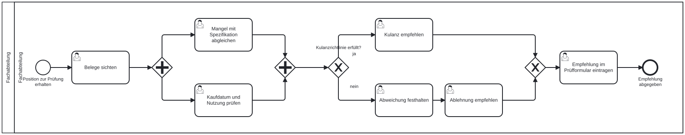

# Übung: Kulanzantrag modellieren

In dieser Übung modellieren wir das Verfahren, mit dem unser Online-Shop Kulanzanträge bearbeitet, als vollständiges BPMN-Kollaborationsdiagramm. Alle Elemente aus diesem Teil kommen vor. Die Übung ist für zwei bis drei Personen gedacht, lässt sich aber auch allein bearbeiten. Als Werkzeug dient [demo.bpmn.io](https://demo.bpmn.io/) im Browser oder der kostenlose [Camunda Modeler](https://camunda.com/download/modeler/).

## Ausgangssituation

Kunden, die mit einer Lieferung unzufrieden sind, aber keinen Anspruch aus Gewährleistung haben, können einen Kulanzantrag stellen. Beteiligt sind die Kunden, der Kundenservice, die für die jeweilige Produktgruppe zuständige Fachabteilung und die Teamleitung des Kundenservice. Das Verfahren läuft wie folgt ab:

1. Der Prozess beginnt, sobald im Kundenservice ein Kulanzantrag eingeht. Die Kunden reichen den Antrag über das Kundenportal ein und fügen die Rechnung sowie Fotos der beanstandeten Positionen bei.
2. Der Kundenservice prüft den Antrag auf Vollständigkeit. Fehlen Belege, fordert er diese bei den Kunden nach.
3. Nach der Nachforderung wartet der Kundenservice. Gehen die Belege ein, wird die Vollständigkeit erneut geprüft. Gehen sie innerhalb von 14 Tagen nicht ein, gilt der Antrag als zurückgezogen: Der Kundenservice informiert die Kunden, und der Prozess endet.
4. Ist der Antrag vollständig, leitet der Kundenservice ihn an die zuständige Fachabteilung weiter. Diese führt die fachliche Prüfung durch und gibt für jede reklamierte Position eine Empfehlung ab (Kulanz gewähren oder nicht gewähren).
5. Liegt die Empfehlung drei Werktage nach der Weiterleitung noch nicht vor, erinnert der Kundenservice die Fachabteilung. Die fachliche Prüfung läuft dabei weiter; sie wird durch die Erinnerung nicht abgebrochen.
6. Auf Grundlage der Empfehlungen entscheidet die Teamleitung des Kundenservice über den Antrag.
7. Anschließend bereitet der Kundenservice den Bescheid vor: Wurde mindestens eine Position anerkannt, verbucht er die Gutschrift im Shop-System. Wurde mindestens eine Position abgelehnt, formuliert er eine schriftliche Begründung mit Hinweis auf die Beschwerdestelle. Bei einer teilweisen Kulanz geschieht beides.
8. Danach erstellt der Kundenservice den Bescheid. Er versendet ihn an die Kunden und archiviert gleichzeitig Antrag und Bescheid in der digitalen Kundenakte. Sind beide Schritte erledigt, ist der Antrag abschließend bearbeitet.

## Aufgabe 1: Fallbeschreibung analysieren (etwa 15 Minuten)

Wir lesen die Fallbeschreibung und tragen die gefundenen Begriffe in die mittlere Spalte ein. In der rechten Spalte steht, mit welchem BPMN-Element wir den Begriff darstellen werden.

| Kategorie | Fundstellen im Text (Nr.) und Begriffe | Geplantes BPMN-Element |
|---|---|---|
| Beteiligte Organisationen | | |
| Rollen innerhalb des Online-Shops | | |
| Auslösendes Ereignis | | |
| Mögliche Ergebnisse des Prozesses | | |
| Entscheidungen | | |
| Wartesituationen und Fristen | | |
| Nachrichten zwischen den Beteiligten | | |
| Dokumente und IT-Systeme | | |

Leitfragen: Wer arbeitet in eigener Verantwortung und kommuniziert nur über Nachrichten? Welche Schritte laufen gleichzeitig ab, welche schließen sich gegenseitig aus, und wo können mehrere Pfade zugleich aktiv sein?

## Aufgabe 2: Kollaborationsdiagramm modellieren (etwa 60 Minuten)

Wir modellieren das Verfahren aus Sicht des Online-Shops als BPMN-Kollaborationsdiagramm. Die Kunden stellen wir als zugeklappten Pool (Black Box) dar und den Online-Shop als Pool mit einer Lane je Rolle. Die fachliche Prüfung aus Schritt 4 modellieren wir hier als zugeklappten Teilprozess.

Das Modell muss jedes der folgenden Elemente mindestens einmal fachlich korrekt verwenden:

- [ ] Pool mit Lanes sowie ein zugeklappter Pool
- [ ] Nachrichtenfluss zwischen den Pools (eingehend und ausgehend)
- [ ] Nachrichten-Startereignis
- [ ] mindestens zwei unterschiedlich benannte Endereignisse
- [ ] Aufgaben, davon mindestens eine Sende- und eine Benutzeraufgabe
- [ ] exklusives Gateway (XOR) mit einer Schleife
- [ ] ereignisbasiertes Gateway mit Nachrichten- und Zeit-Zwischenereignis
- [ ] nicht unterbrechendes Zeit-Randereignis (Boundary Event)
- [ ] inklusives Gateway (OR) mit passendem Zusammenführungs-Gateway
- [ ] paralleles Gateway (AND) mit passendem Zusammenführungs-Gateway
- [ ] zugeklappter Teilprozess
- [ ] mindestens zwei Datenobjekte und ein Datenspeicher, jeweils mit Assoziation
- [ ] eine Textanmerkung, die eine fachliche Regel aus dem Text festhält

## Aufgabe 3: Teilprozess „Fachliche Prüfung“ detaillieren (etwa 20 Minuten)

Wir modellieren den Teilprozess aus Aufgabe 2 in einem eigenen Diagramm. Er läuft vollständig in der Fachabteilung ab und besteht aus folgenden Schritten:

1. Die Fachabteilung sichtet die eingereichten Belege.
2. Danach gleicht sie den gemeldeten Mangel mit der Produktspezifikation ab und prüft Kaufdatum und bisherige Nutzung. Beide Prüfungen sind voneinander unabhängig und können in beliebiger Reihenfolge erfolgen.
3. Erfüllt die Position die Kulanzrichtlinie, empfiehlt sie Kulanz. Andernfalls hält sie die Abweichung fest und empfiehlt die Ablehnung.
4. Abschließend trägt sie ihre Empfehlung in das Prüfformular ein.

Im Diagramm aus Aufgabe 2 kennzeichnen wir zusätzlich, dass der Teilprozess für jede reklamierte Position einmal durchlaufen wird. Welcher Marker ist dafür vorgesehen, und finden die Durchläufe parallel oder nacheinander statt?

## Aufgabe 4: Modell begründen (etwa 15 Minuten)

Wir beantworten die folgenden Fragen jeweils in zwei bis drei Sätzen:

1. Warum eignet sich nach der Nachforderung ein ereignisbasiertes Gateway besser als ein exklusives Gateway?
2. Was würde sich am Prozessablauf ändern, wenn das Zeit-Randereignis aus Schritt 5 unterbrechend wäre?
3. Warum verwenden wir in Schritt 7 ein inklusives Gateway und kein exklusives oder paralleles Gateway?
4. Warum werden Kundenservice, Fachabteilung und Teamleitung als Lanes eines Pools modelliert, die Kunden dagegen als eigener Pool?
5. An welcher Stelle im Prozess ist die Durchlaufzeit gefährdet, und welche Verbesserung schlagen wir vor?

## Zusatzaufgabe: Rücknahme des Antrags (optional)

Kunden können ihren Antrag zurücknehmen, solange die Teamleitung noch nicht entschieden hat. Geht eine Rücknahme ein, wird die laufende Bearbeitung sofort abgebrochen. Der Kundenservice bestätigt den Kunden die Rücknahme, und der Prozess endet.

Wir erweitern das Modell entsprechend. Dazu fassen wir die betroffenen Schritte so zusammen, dass ein einziges Ereignis die Bearbeitung an jeder Stelle beenden kann. Verwenden wir ein unterbrechendes oder ein nicht unterbrechendes Ereignis, und warum?

## Modellierungsregeln und Abgabe

| Element | Benennungsregel | Beispiel |
|---|---|---|
| Aufgabe | Objekt + Verb im Infinitiv | Antrag prüfen |
| Ereignis | Objekt + Partizip (Zustand) | Antrag eingegangen |
| Exklusives Gateway | Frage; ausgehende Kanten mit den Antworten beschriftet | Antrag vollständig? ja / nein |
| Pool / Lane | Organisation bzw. Rolle, keine Person | Kundenservice |

- Sequenzflüsse verbinden nur Elemente innerhalb eines Pools; zwischen Pools gibt es ausschließlich Nachrichtenflüsse.
- Jeder Pfad endet in einem Endereignis; Verzweigungen werden mit einem Gateway desselben Typs wieder zusammengeführt.
- Wir modellieren von links nach rechts und vermeiden sich kreuzende Kanten, wo es möglich ist.

**Abgabe:** je Gruppe die Modelldateien (.bpmn) aus Aufgabe 2 und 3, ein PDF oder SVG mit den Diagrammen sowie die Antworten zu Aufgabe 4.

## Musterlösung

Die Musterlösung ist eine mögliche Lösung. Andere Layouts und abweichende Aufgabennamen sind richtig, wenn die Semantik stimmt und die Checkliste erfüllt ist.

::: {.callout-note title="Aufgabe 2: Kollaborationsdiagramm" collapse="true"}
{#fig-kulanzantrag-loesung width="100%"}

Modelldatei: [kulanzantrag-loesung.bpmn](loesung/kulanzantrag-loesung.bpmn), Bild in voller Auflösung: [kulanzantrag-loesung.png](loesung/kulanzantrag-loesung.png).

Wie die Checkliste erfüllt ist:

| Element | Im Modell |
|---|---|
| Pool mit Lanes, zugeklappter Pool | „Online-Shop“ mit Kundenservice, Fachabteilung, Teamleitung Kundenservice; „Kunde“ zugeklappt |
| Nachrichtenfluss ein- und ausgehend | Antrag mit Belegen, Belege (eingehend); Nachforderung, Mitteilung, Bescheid (ausgehend) |
| Nachrichten-Startereignis | „Antrag eingegangen“ |
| Zwei Endereignisse | „Antrag zurückgezogen“, „Erinnerung versendet“, „Antrag abschließend bearbeitet“ |
| Sende- und Benutzeraufgabe | „Belege nachfordern“ (senden), „Antrag auf Vollständigkeit prüfen“ (Benutzer) |
| XOR mit Schleife | „Antrag vollständig?“; der Pfad über das Nachrichten-Zwischenereignis „Belege eingegangen“ führt zurück zur Prüfung |
| Ereignisbasiertes Gateway | nach „Belege nachfordern“, mit „Belege eingegangen“ und „14 Tage verstrichen“ |
| Nicht unterbrechendes Zeit-Randereignis | „3 Werktage ohne Empfehlung“ am Teilprozess, führt zu „Fachabteilung erinnern“ |
| OR mit Zusammenführung | „Ergebnis der Entscheidung?“ vor „Gutschrift verbuchen“ und „Ablehnung begründen“ |
| AND mit Zusammenführung | vor „Bescheid versenden“ und „Antrag und Bescheid archivieren“ |
| Zugeklappter Teilprozess | „Reklamierte Position prüfen“ mit Mehrfach-Marker (parallel) |
| Datenobjekte und Datenspeicher | „Kulanzantrag mit Belegen“, „Bescheid“; „Shop-System“, „Kundenakte“ |
| Textanmerkung | Frist von 14 Tagen; Hinweis auf beide Pfade bei teilweiser Kulanz |
:::

::: {.callout-note title="Aufgabe 3: Teilprozess" collapse="true"}
{#fig-kulanzantrag-pruefung width="100%"}

Modelldatei: [kulanzantrag-pruefung.bpmn](loesung/kulanzantrag-pruefung.bpmn). Der Marker im Hauptdiagramm ist der Mehrfach-Marker mit drei senkrechten Strichen: Die Prüfungen der einzelnen Positionen sind voneinander unabhängig und können parallel laufen. Baut die Prüfung einer Position auf dem Ergebnis der vorigen auf, wäre der sequenzielle Marker richtig.
:::

::: {.callout-note title="Aufgabe 4: Begründungen" collapse="true"}
1. **Ereignisbasiertes Gateway.** Nach der Nachforderung liegt keine Information vor, nach der entschieden werden könnte. Der Prozess wartet darauf, was zuerst eintritt: die Belege oder das Ende der Frist. Ein exklusives Gateway würde sofort nach Daten entscheiden, die es noch nicht gibt.
2. **Unterbrechendes Randereignis.** Die fachliche Prüfung würde nach drei Werktagen abgebrochen, und der Prozess liefe nur noch auf dem Erinnerungspfad weiter. Die Empfehlung käme nie, und der Antrag bliebe ohne Entscheidung. Nicht unterbrechend ist richtig, weil die Erinnerung eine Nebentätigkeit ist.
3. **Inklusives Gateway.** Bei teilweiser Kulanz müssen beide Pfade laufen, bei voller Kulanz oder voller Ablehnung nur einer. Ein exklusives Gateway könnte „beides“ nicht abbilden, ein paralleles Gateway würde auch bei voller Kulanz eine Ablehnung begründen.
4. **Lanes und Pool.** Kundenservice, Fachabteilung und Teamleitung arbeiten am selben Antrag in einer Reihenfolge und sehen dieselben Daten; Übergaben sind Sequenzflüsse. Die Kunden führen ihren eigenen Ablauf, den wir nicht sehen, und kommunizieren nur über Nachrichten; das ist ein eigener Pool.
5. **Durchlaufzeit.** Gefährdet ist sie bei der fachlichen Prüfung (bis zu drei Werktage, bevor überhaupt erinnert wird) und bei der Nachforderung (bis zu 14 Tage Wartezeit). Verbesserungen: eine Vollständigkeitsprüfung schon im Kundenportal, bevor der Antrag eingeht, oder eine automatische Erinnerung an die Fachabteilung nach einem statt nach drei Werktagen. Im n8n-Workflow wäre das ein Wait-Knoten mit kürzerer Frist.
:::

::: {.callout-note title="Zusatzaufgabe: Rücknahme" collapse="true"}
Wir fassen alle Schritte von „Antrag auf Vollständigkeit prüfen“ bis „Über Kulanz entscheiden“ in einem aufgeklappten Teilprozess „Antrag bearbeiten“ zusammen und hängen an seinen Rand ein **unterbrechendes** Nachrichten-Randereignis „Rücknahme eingegangen“ mit Nachrichtenfluss vom Kunden-Pool. Von dort führt eine Sendeaufgabe „Rücknahme bestätigen“ zu einem Endereignis „Antrag zurückgenommen“. Unterbrechend ist richtig, weil die laufende Bearbeitung sofort abgebrochen werden soll; ein nicht unterbrechendes Ereignis ließe die Prüfung weiterlaufen. Dass die Rücknahme nur bis zur Entscheidung möglich ist, ergibt sich aus der Grenze des Teilprozesses: Nach „Über Kulanz entscheiden“ ist das Randereignis nicht mehr aktiv.
:::

## Kontrollpunkt

- Eine Fallbeschreibung systematisch in Organisationen, Rollen, Ereignisse, Entscheidungen, Fristen, Nachrichten und Daten zerlegen
- Ein Kollaborationsdiagramm mit allen Elementen der Checkliste in demo.bpmn.io oder im Camunda Modeler erstellen
- Einen Teilprozess in einem eigenen Diagramm detaillieren und den passenden Mehrfach-Marker wählen
- Modellentscheidungen zu Gateway-Typ, Randereignis und Pool-Zuschnitt fachlich begründen
