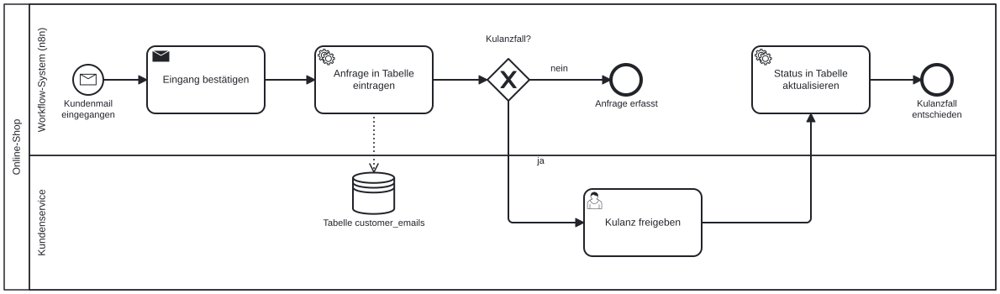

# Vom Modell zum n8n-Workflow

Ein fertiges BPMN-Modell ist der Bauplan für den Workflow. Jedes Element hat ein Gegenstück in n8n, und wer die Zuordnung kennt, baut den Workflow in der Reihenfolge des Modells statt nach Gefühl. In diesem Kapitel legen wir die Zuordnung fest, lassen ein Sprachmodell aus einer Schrittliste einen BPMN-Entwurf schreiben und prüfen das Ergebnis mit einer festen Liste. Denn ein KI-Entwurf sieht überzeugend aus, auch wenn darin Schritte stehen, die es im Ablauf nie gab.

## Das Modell des Demo-Szenarios

Wir beginnen mit dem Szenario, das den Kurs begleitet: Eine Kundenmail geht ein, wird bestätigt und in die Tabelle `customer_emails` eingetragen. Kulanzfälle brauchen eine Freigabe durch einen Menschen.

{#fig-zum-workflow width="100%"}

Das Modell beantwortet schon jetzt, was der Workflow können muss: einen Trigger für eingehende Mails, zwei automatische Schritte, eine Verzweigung, eine Wartestelle für einen Menschen und einen Datenspeicher. Die Lane „Workflow-System (n8n)“ enthält alles, was von allein läuft; die Lane „Kundenservice“ enthält die einzige Stelle, an der ein Mensch gebraucht wird.

## Die Zuordnung

| BPMN-Element | n8n-Baustein | Hinweis |
|---|---|---|
| Nachrichten-Startereignis | App-Trigger: Email Trigger (IMAP, Mail-Abruf), Gmail Trigger, Webhook (Aufruf durch ein anderes Programm), Form Trigger (ausgefülltes Formular) | Der Trigger bestimmt, welche Daten der Workflow am Anfang hat. |
| Zeit-Startereignis | Schedule Trigger | Cron-ähnliche Zeitpläne: täglich, wöchentlich, zum Monatsende. |
| Serviceaufgabe | Ein Knoten: Data Table (eingebaute Tabelle), HTTP Request (Aufruf einer Schnittstelle), Set (Felder setzen), Google Sheets, CRM-Knoten | Läuft ohne Rückfrage durch. |
| Sendeaufgabe | Send Email, Gmail, Slack, Microsoft Teams | Versand an einen anderen Pool. |
| Exklusives Gateway (XOR) | IF (zwei Ausgänge) oder Switch (mehrere Ausgänge) | Die Frage am Gateway wird zur Bedingung im Knoten. |
| Paralleles Gateway (AND) | Mehrere ausgehende Verbindungen von einem Knoten, Zusammenführung mit Merge | n8n führt Zweige nacheinander aus, nicht gleichzeitig; das Ergebnis ist dasselbe. |
| Inklusives Gateway (OR) | Mehrere IF-Knoten, die unabhängig prüfen, Zusammenführung mit Merge | Der Standardfluss ist der Fall, in dem keine Bedingung greift. |
| Zeit-Zwischenereignis | Wait (Resume: After Time Interval oder At Specified Time) | Der Workflow pausiert und läuft danach weiter. |
| Ereignisbasiertes Gateway | Wait (Resume: On Webhook Call oder On Form Submitted) mit Zeitlimit | Weiter bei Antwort oder bei Fristablauf, was zuerst eintritt. |
| Benutzeraufgabe, Freigabe | Form-Knoten, oder ein Knoten mit „Send and Wait for Response“ (Gmail, Slack) | Der Workflow hält an, bis ein Mensch bestätigt oder ablehnt. |
| Empfangsaufgabe | Wait (On Webhook Call) oder eigener Trigger in einem zweiten Workflow | Je nachdem, ob die Nachricht auf den laufenden Workflow bezogen ist. |
| Datenspeicher | Data Table, Google Sheets, Datenbank-Knoten | Der Name des Speichers im Modell ist der Name der Tabelle im Workflow. |
| Teilprozess | Execute Sub-workflow | Ein eigener Workflow, der aufgerufen wird. |
| Mehrfach-Marker | Verhalten je Item; bei großen Mengen Loop Over Items | n8n führt jeden Knoten für jedes Item aus. |
| Fehler-Ereignis | Error Trigger oder Fehlerausgang eines Knotens („Continue on Error“) | Ein eigener Pfad für den Fehlerfall. |
| Pool „Kunde“ | Kein Baustein | Der Kunde ist außerhalb des Workflows; seine Nachrichten sind Trigger und Wait-Eingänge. |

::: {.callout-note title="Was n8n anders macht als BPMN"}
Zwei Unterschiede sollten wir kennen. Erstens kennt n8n keine echte Parallelität: Zweige nach einer Verzweigung laufen nacheinander. Für fachliche Modelle spielt das keine Rolle, weil das Ergebnis gleich ist. Zweitens arbeitet n8n mit **Items**: Ein Knoten läuft für jedes Element seiner Eingabe. Was BPMN mit dem Mehrfach-Marker ausdrücklich macht, ist in n8n das Normalverhalten.
:::

## Die Reihenfolge beim Bauen

Aus dem Modell wird der Workflow in vier Schritten:

1. **Trigger wählen.** Das Startereignis bestimmt den Trigger und damit die Felder, mit denen der Workflow arbeitet.
2. **Den Hauptpfad bauen.** Alle Serviceaufgaben auf dem Weg vom Start zum häufigsten Ende als Knoten in Reihe, mit Mock-Daten getestet.
3. **Gateways ergänzen.** Jedes XOR-Gateway wird zu einem IF-Knoten; die Antworten an den Kanten werden zu den Bedingungen.
4. **Wartestellen einbauen.** Benutzeraufgaben, Zeit-Zwischenereignisse und ereignisbasierte Gateways werden zu Wait- oder Form-Knoten. Diese Stellen zuletzt, weil sie beim Testen am meisten Zeit kosten.

Für das Demo-Szenario heißt das: Email Trigger, Send Email, Data Table, dann ein IF-Knoten „Kulanzfall?“, dann der Freigabeschritt. Genau in dieser Reihenfolge entsteht der Workflow im Teil „Erste Workflows“.

## Mit KI vom Formular zum Modell

In der Willkommenslektion ist eine Schrittliste entstanden: der Ablauf in einem Satz, Häufigkeit und Aufwand, die Schritte mit der Zuordnung zu Regel, KI-Schritt oder Mensch, und die beteiligten Systeme. Aus dieser Liste kann ein Sprachmodell einen BPMN-Entwurf schreiben. Der folgende Auftrag ist dafür gebaut. Die Stellen in spitzen Klammern ersetzen wir durch die Angaben aus der Schrittliste.

```text
Kontext: Ich beschreibe einen wiederkehrenden Arbeitsablauf aus meinem
Unternehmen. Er soll später als Workflow in n8n automatisiert werden.
Ablauf (ein Satz mit Auslöser und Ergebnis): <Ablauf>
Häufigkeit und Aufwand: <Häufigkeit und Aufwand>
Schritte, je Zeile ein Schritt und dahinter, wer ihn künftig erledigt
(Regel, KI-Schritt oder Mensch):
<Schritte>
Beteiligte Systeme: <Systeme>

Aufgabe: Erstelle daraus einen Entwurf für ein BPMN-2.0-Modell. Verwende
nur diese Elemente: Startereignis (Nachricht oder Zeit), Endereignis,
Aufgabe mit Typ, exklusives Gateway, paralleles Gateway, Zeit-Zwischen-
ereignis, Datenspeicher. Ordne jeder Aufgabe einen Typ zu: Schritte mit
„Regel“ oder „KI-Schritt“ sind Serviceaufgaben, Versand ist eine
Sendeaufgabe, Schritte mit „Mensch“ sind Benutzeraufgaben. Lege einen
Pool für mein Unternehmen mit einer Lane „Workflow-System“ und je einer
Lane pro menschlicher Rolle an. Externe Beteiligte, die nur Nachrichten
schicken oder empfangen, sind zugeklappte Pools.

Benennung: Aufgaben als Objekt plus Verb im Infinitiv („Anfrage
prüfen“), Ereignisse als Objekt plus Partizip („Anfrage eingegangen“),
Gateways als Frage mit beschrifteten Ausgängen („Kulanzfall? ja / nein“).

Format: Zuerst eine Tabelle mit den Spalten Nr., Element (Start, Aufgabe,
Gateway, Ereignis, Ende), Name, Typ, Lane, Danach (Nummer des nächsten
Elements oder bei Gateways die Ausgänge mit Antwort). Dann eine Liste der
Datenspeicher mit den Aufgaben, die darauf zugreifen. Dann eine Liste
der Nachrichtenflüsse zwischen den Pools.

Prüfung: Erfinde keine Schritte, die nicht in meiner Liste stehen. Wo
etwas unklar ist (fehlende Entscheidung, fehlendes Ende, unklare Frist,
unklare Zuständigkeit), füge in der Tabelle keinen Schritt hinzu, sondern
schreibe in die Spalte Name „OFFEN:“ und eine Frage an mich. Gib am Ende
alle offenen Fragen als nummerierte Liste aus.
```

Den Entwurf zeichnen wir anschließend in demo.bpmn.io nach. Das Nachzeichnen ist Absicht: Beim Zeichnen prüfen wir jeden Schritt noch einmal. Wer eine fertige Datei möchte, ersetzt den Teil „Format“ durch die Bitte um eine vollständige BPMN-2.0-XML-Datei mit Diagrammteil (BPMNDiagram mit Koordinaten) und öffnet die gespeicherte Datei in demo.bpmn.io; meist braucht das eine zweite Runde mit der Fehlermeldung des Editors.

::: {.callout-important title="Nur freigegebene Werkzeuge, nur anonymisierte Angaben"}
Wir verwenden ein KI-Werkzeug, das im eigenen Unternehmen für solche Inhalte freigegeben ist. Die Schrittliste enthält keine Namen von Kundinnen, Kunden oder Kolleginnen und keine internen Kennzahlen, die nicht nach außen dürfen. Im Zweifel beschreiben wir allgemeiner: „eine Kundin“, „das Buchhaltungssystem“.
:::

## Die Prüfliste

Jeden Entwurf, ob von Hand oder mit KI, prüfen wir mit denselben Fragen. Ein KI-Modell gilt erst nach dieser fachlichen Prüfung als Modell.

| Nr. | Prüffrage | Erfüllt, wenn |
|---|---|---|
| 1 | Kommt jeder Schritt in der Schrittliste vor? | Kein Schritt ist erfunden. |
| 2 | Hat jede Aufgabe einen Typ, und passt er zur Zuordnung Regel, KI-Schritt oder Mensch? | Menschliche Arbeit ist Benutzeraufgabe, Automatisches ist Serviceaufgabe. |
| 3 | Liegt jede Aufgabe in genau einer Lane, und ist die Lane eine Rolle oder ein System? | Keine Lane mit Personennamen, keine Lane „Sonstiges“. |
| 4 | Hat jedes Gateway eine Frage und beschriftete Ausgänge? | Keine Raute ohne Text. |
| 5 | Wird mit dem Typ zusammengeführt, mit dem verzweigt wurde? | Keine gemischten Gateway-Paare. |
| 6 | Ist jede Wartesituation mit einer Frist versehen? | Kein ereignisbasiertes Gateway ohne Zeitereignis. |
| 7 | Sind alle Enden mit einem Zustand benannt? | Jedes Ergebnis ist erkennbar. |
| 8 | Laufen Sequenzflüsse nur innerhalb von Pools und Nachrichtenflüsse nur zwischen Pools? | Kein Pfeil über eine Pool-Grenze. |
| 9 | Sind offene Fragen festgehalten statt geglättet? | Jede Unklarheit steht als Frage im Entwurf. |
| 10 | Enthält das Modell keine Personendaten? | Nur Rollen, keine Namen. |

KI-Entwürfe fallen am häufigsten bei den Fragen 1, 4 und 9 durch: Ein Prüfschritt, der „sinnvoll wäre“, steht plötzlich im Modell, ein Gateway hat nur einen beschrifteten Ausgang, oder eine Unklarheit wurde stillschweigend zu einer Annahme. Das korrigieren wir, bevor wir den ersten Knoten in n8n anlegen.

## Arbeitsauftrag: die eigene Schrittliste modellieren

**Zeitbedarf:** etwa 30 Minuten

**Voraussetzungen:**

- Die Schrittliste aus der Willkommenslektion
- Ein im Unternehmen freigegebenes Chat-Werkzeug; ist keines freigegeben, das Demo-Szenario des Kurses als Schrittliste verwenden
- Browser mit Zugang zu [demo.bpmn.io](https://demo.bpmn.io/)

**Schritte:**

1. Den Auftrag kopieren und die Platzhalter mit der eigenen Schrittliste füllen.
2. Den Auftrag im Chat-Werkzeug ausführen.
3. Die offenen Fragen am Ende der Antwort beantworten und den Entwurf überarbeiten lassen.
4. Den Entwurf mit der Prüfliste Frage für Frage prüfen.
5. Den geprüften Entwurf in demo.bpmn.io nachzeichnen.
6. Für jede Aufgabe mit dem Typ Serviceaufgabe den n8n-Baustein aus der Zuordnungstabelle notieren.
7. Das Diagramm als BPMN-Datei und als SVG-Bild herunterladen.

**Prüfen:** Der Auftrag ist erfüllt, wenn das Modell alle zehn Prüffragen besteht und für jede Serviceaufgabe ein n8n-Baustein feststeht.

## Kontrollpunkt

- Jedem BPMN-Element aus diesem Teil den passenden n8n-Baustein zuordnen
- Die vier Schritte beim Bauen eines Workflows aus einem Modell in der richtigen Reihenfolge nennen
- Mit dem Auftrag aus einer Schrittliste einen BPMN-Entwurf erzeugen lassen
- Einen Entwurf mit der Prüfliste kontrollieren und die typischen Schwächen von KI-Entwürfen erkennen
