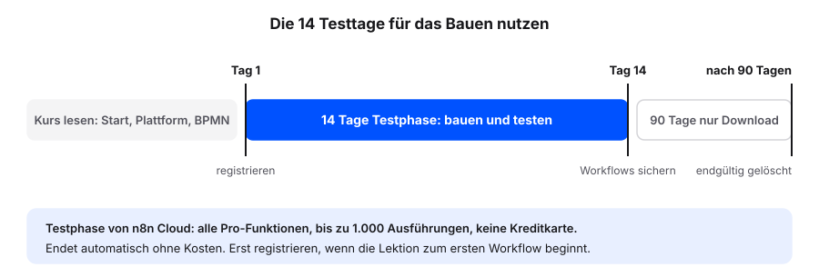

# n8n-Testzugang einrichten

Für die Übungen in diesem Teil brauchen wir eine eigene n8n-Umgebung. Am einfachsten ist die Testphase von n8n Cloud: n8n betreibt die Technik, wir müssen nichts installieren und keinen Server pflegen. Die Testphase dauert 14 Tage, enthält alle Funktionen des Pro-Tarifs und bis zu 1.000 Ausführungen. Eine Kreditkarte ist nicht nötig [@n8nCloudTrial].

## Der richtige Zeitpunkt

Die 14 Tage beginnen mit der Registrierung. Wir starten die Testphase deshalb erst, wenn wir tatsächlich bauen wollen, also direkt vor der Lektion zum ersten Workflow. Bei einer Registrierung zum Kursstart laufen die Testtage sonst schon während der Lesekapitel ab.

## Testzugang anlegen

Voraussetzung: eine E-Mail-Adresse, auf die wir Zugriff haben, und ein aktueller Browser.

1. Die Registrierungsseite von n8n Cloud öffnen: <https://app.n8n.cloud/register>.
2. Die E-Mail-Adresse in das Feld **Company email** eintragen.
3. Auf **Continue** klicken.
4. Die weiteren Abfragen ausfüllen, etwa Name und Passwort.
5. Einen kurzen Namen für den Workspace wählen, wenn danach gefragt wird. Er wird Teil der Adresse, zum Beispiel `ihr-name.app.n8n.cloud`.
6. Die E-Mail-Adresse über den Link in der Bestätigungsmail bestätigen, falls n8n eine schickt.
7. Die Adresse der eigenen Instanz notieren. Die Anleitungen im Kurs fragen später danach.

**Prüfen:** Nach der Anmeldung öffnet sich die Übersicht von n8n (Overview). Über **Create workflow** entsteht ein leerer Canvas mit Plus-Symbol.

::: {.callout-warning title="Keine echten Kundendaten"}
Die Testphase dient zum Lernen. Wir arbeiten mit den simulierten Daten aus dem Kurs und tragen keine echten Kunden-, Patienten- oder Personaldaten ein.
:::

## Was nach 14 Tagen passiert

Die Testphase endet automatisch, es entstehen keine Kosten und wir müssen nichts kündigen. Ohne Upgrade löscht n8n danach den Workspace mit allen Daten. Workflows lassen sich noch 90 Tage nach dem Ende herunterladen [@n8nCloudTrial]. Für die weitere Arbeit gibt es drei Wege (siehe [Betrieb wählen](../overview/hosting.qmd)):

- auf einen bezahlten Cloud-Tarif wechseln
- die Workflows als JSON exportieren und in einer eigenen Instanz importieren
- ein Managed Hosting nutzen

::: {.callout-tip title="Vor Ablauf sichern"}
Am letzten Testtag die eigenen Workflows über das Drei-Punkte-Menü im Editor mit **Download** als Datei sichern. So bleibt die Arbeit unabhängig vom weiteren Vorgehen erhalten.
:::
