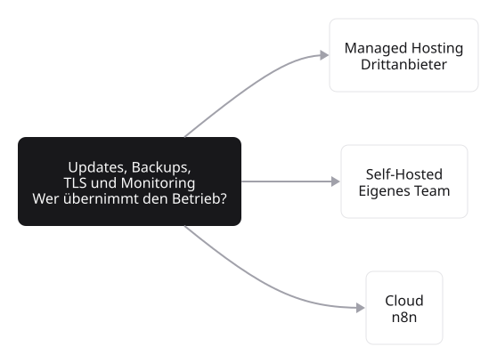
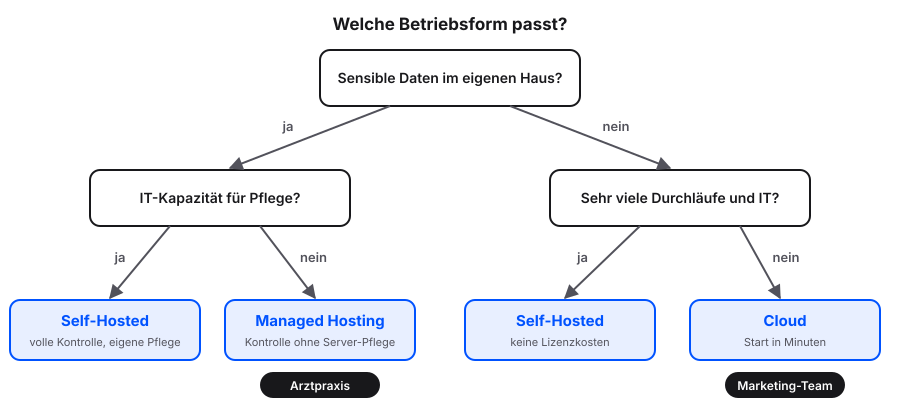

# Betrieb wählen

Drei Pfade führen zu einer laufenden n8n-Instanz. Die Wahl hängt weniger von der Größe des Vorhabens ab als von drei Faktoren: dem erwarteten Volumen an Workflow-Ausführungen, der Empfindlichkeit der Daten und den verfügbaren IT-Skills im Team.

## Überblick

| | Cloud | Managed Hosting | Self-Hosted |
|---|---|---|---|
| Wer betreibt die Technik? | n8n selbst | ein Anbieter, z. B. InstaPods | das eigene Team |
| Kosten | ab ca. 24 € im Monat für 2.500 Executions | ab ca. 7 € im Monat | keine Lizenz, Server ab ca. 5 € im Monat |
| Eigener Aufwand | keiner | kaum | 1 bis 2 Std. Einrichtung, 1 bis 3 Std. Pflege im Monat |
| Start | in Minuten | kurzfristig | nach der Einrichtung |
| Kontrolle über Daten | Daten beim Hersteller | eigene Instanz, EU-Server wählbar | volle Kontrolle |
| Anpassbarkeit | im Rahmen des Tarifs | begrenzt | vollständig |
| **Passt, wenn …** | erste Schritte, keine IT im Team | sensible Daten, aber keine IT | sensible Daten oder hohes Volumen, IT vorhanden |

: Drei Betriebsformen im Überblick. Preise sind Größenordnungen.

## Cloud

Die n8n-Cloud ist eine SaaS-Variante (Software, die im Internet gemietet statt installiert wird), die n8n selbst betreibt. Konto anlegen, Workspace einrichten und loslegen, das geht alles innerhalb weniger Minuten ohne Server-Wartung.

**Eigenschaften:**

- Geringer Setup-Aufwand, keine Server-Wartung, kein Update-Aufwand
- Ab rund 24 € im Monat für 2.500 Executions, der Pro-Tarif ab rund 50 € im Monat
- Geeignet für Teams ohne dedizierte IT-Ressourcen oder für erste Schritte

::: {.callout-tip}
Für eine erste Lernphase ist die Cloud-Variante eine pragmatische Option, weil Serverbetrieb mit Linux, Docker (Software-Container) oder TLS-Zertifikaten (für verschlüsselte Verbindungen) dabei kein Thema ist. Wer später Self-Hosting betreiben will, kann Workflows als JSON (ein Textformat für Daten) exportieren und in eine eigene Instanz übertragen.
:::

## Self-Hosted

Die Community Edition von n8n nutzt eine [Fair-Code]{.highlight}-Lizenz: Quellcode öffentlich, kostenlose Nutzung und Anpassung erlaubt, Wiederverkauf als konkurrierender Managed-Service ausgeschlossen. Damit unterscheidet sich Fair-Code von klassischen Open-Source-Lizenzen wie MIT oder Apache, die auch kommerzielle Konkurrenz-Angebote zulassen. n8n läuft auf jeder beliebigen Maschine, vom Raspberry Pi im Heimnetz bis zum Cloud-Server bei Hetzner, AWS oder Azure.

**Eigenschaften:**

- Unbegrenzte Workflows, Ausführungen und Nutzer
- Keine Lizenzkosten; auf vorhandener Hardware (eigener Server, Arbeitsplatz-Rechner, Raspberry Pi im Heimnetz) entstehen keine zusätzlichen Kosten. Wer keine eigene Hardware nutzen möchte, kann einen  virtuellen Server bei einem Cloud-Anbieter wie Hetzner, DigitalOcean oder AWS mieten, ab rund 5 € im Monat
- 1 bis 2 Stunden initialer Setup-Aufwand, danach ca. 1 bis 3 Stunden pro Monat Wartung
- Volle Kontrolle über Daten, Backups und Update-Zeitpunkte

::: {.callout-important title="Was Self-Host wirklich bedeutet"}
Self-Host ist nicht nur eine Installation. Wer eine eigene Instanz betreibt, verantwortet auch:

- Regelmäßige Updates der n8n-Version
- Backup-Strategie für Workflows und Credentials
- TLS-Zertifikate und sichere Erreichbarkeit
- Monitoring und Logging im laufenden Betrieb

Diese Aufgaben sind technisch beherrschbar, erfordern aber kontinuierlichen Aufwand. Vor einer Entscheidung für Self-Host sollte daher geklärt sein, wer die Pflege der Instanz im laufenden Betrieb übernimmt.
:::

## Managed Hosting

Spezialisierte Anbieter wie InstaPods betreiben Self-Host-Instanzen für ihre Kunden. Die Kunden behalten die Datenkontrolle einer eigenen Instanz, ohne die Maschine selbst zu pflegen.

**Eigenschaften:**

- Ab rund 7 € im Monat für eine Basis-Instanz
- Keine Lizenzkosten, keine eigene Server-Pflege
- Daten bleiben auf europäischen Servern, je nach Anbieter wählbar
- Begrenzte Anpassbarkeit gegenüber einer eigenen Maschine

Diese Variante eignet sich für Teams, die die Kostenstruktur von Self-Host nutzen möchten, ohne den Linux-Server-Betrieb selbst zu übernehmen.

## Drei Fragen, die die Entscheidung leiten

Statt mit einem Tool-Vergleich zu starten, lohnen sich drei vorgelagerte Fragen.

### Volumen: wie viele Ausführungen pro Monat?

Bei der Cloud-Variante steigen die Kosten mit der Anzahl der Executions, bei Self-Host und Managed Hosting bleiben die Server-Kosten konstant. Reine Lizenz- und Server-Kosten von Self-Host (ab rund 5 € im Monat) liegen meist unter den Cloud-Tarifen. Der praktische Aufwand fällt aber unterschiedlich aus: Cloud benötigt keine Wartung, Self-Host schon.

### Souveränität: welche Daten verlassen die eigene Infrastruktur?

In regulierten Branchen ist Datensouveränität nicht optional, sondern Pflicht. Patientendaten, Kundenkontakte mit besonderem Schutzbedarf oder interne Prozessdokumente werfen die Frage auf, wo sie verarbeitet werden dürfen. Für viele Anwendungsfälle scheiden Cloud-Hosts in den USA aus; EU-Cloud-Hosts oder eigenes Hosting bleiben als Optionen. Hetzner etwa betreibt Rechenzentren in Deutschland und Finnland, was die Anforderungen der DSGVO (Datenschutz-Grundverordnung der EU) vereinfacht.

### Skill-Bestand: wer pflegt die Instanz?

Ohne IT-Kapazität sind Cloud oder Managed Hosting realistische Optionen. Eine Self-Host-Instanz, die nicht aktualisiert und überwacht wird, wird auf Dauer zum Sicherheits-Risiko. Diese Frage gehört vor jede technische Diskussion.

## Übersicht zur Auswahl

| Situation | Passende Option |
|---|---|
| Erste Schritte, kleines Team, keine IT | **Cloud** |
| Sensible Daten, IT-Team vorhanden | **Self-Hosted** |
| Sensible Daten, keine IT | **Managed Hosting** |
| Hohe Volumen, niedrige Lizenzkosten gewünscht | **Self-Hosted** |
| Lernen und Experimentieren | **Cloud** oder lokale Docker-Instanz |

::: {.callout-note}
Die Übersicht zeigt typische Zuordnungen, keine starren Regeln. Wer mit der Cloud-Variante startet und später wechselt, kann Workflows als JSON-Datei exportieren und in der neuen Instanz importieren. Der Wechsel ist reversibel; die erste Wahl muss daher nicht endgültig sein.
:::
