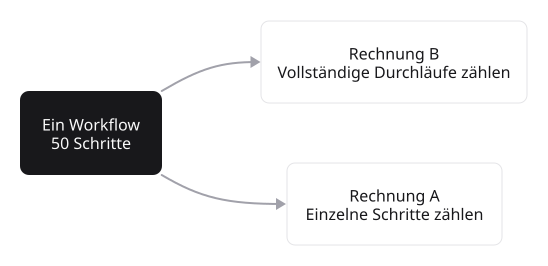
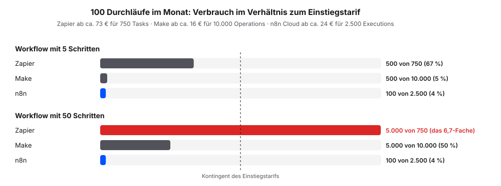

# Werkzeuge im Vergleich

Die Abrechnungslogik unterscheidet sich zwischen n8n und den klassischen iPaaS-Anbietern grundlegend. Der Begriff iPaaS (Integration Platform as a Service) bezeichnet Cloud-Plattformen, die Anwendungen, Daten und Prozesse miteinander verbinden, ohne dass eine eigene Integrationssoftware betrieben werden muss. Zapier und Make sind die bekanntesten Vertreter dieser Kategorie.

Die zentrale Achse des Vergleichs ist die Abrechnungseinheit: Klassische Anbieter rechnen pro Task ab, n8n pro Workflow-Execution. Diese Logik beeinflusst, wie Workflows zugeschnitten werden.

## Überblick

| | n8n | Zapier | Make |
|---|---|---|---|
| Abrechnung | pro Durchlauf (Execution) | pro Schritt (Task) | pro Schritt (Operation) |
| Einstiegstarif | ab ca. 24 € im Monat für 2.500 Executions | ab ca. 73 € im Monat für 750 Tasks | ab ca. 16 € im Monat für 10.000 Operations |
| Selbst betreiben | ja, ohne Lizenzkosten | nein, nur Cloud | nein, nur Cloud |
| KI-Bausteine | eingebaut | teilweise, oft zugekauft | teilweise, oft zugekauft |
| Code-Schritte | JavaScript und Python | eingeschränkt | eingeschränkt |
| Einstieg | mittlere Lernkurve | flach | flach |
| **Passt, wenn …** | lange Workflows, KI oder eigener Betrieb wichtig | wenige Schritte, schneller Einstieg | wenige Schritte, viele Durchläufe |

: Drei Werkzeuge im Überblick. Preise sind Größenordnungen, alle Anbieter ändern ihre Tarife regelmäßig.

## Zwei Abrechnungsmodelle

Klassische Anbieter wie Zapier oder Make rechnen **pro Task** ab. Jeder einzelne Schritt in einem Workflow zählt. Bei hunderttausend Tasks pro Monat liegen die Lizenzkosten bei mehreren hundert Euro.

n8n rechnet **pro Workflow-Execution** ab. Eine vollständige Workflow-Ausführung gilt als eine Einheit, unabhängig von der Anzahl der Schritte. Ein Workflow mit fünfzig Knoten wird gleich abgerechnet wie ein Workflow mit fünf, solange beide einmal laufen.

::: {.callout-important title="Was das praktisch bedeutet"}
Die Abrechnungslogik formt das Workflow-Design. Bei Per-Task-Abrechnung lohnt es sich, Schritte zu konsolidieren. Bei Per-Execution-Abrechnung spielt die Anzahl der Schritte für die Kosten keine Rolle. Welches Modell besser passt, hängt vom Einsatzprofil ab.
:::

## Konkrete Größenordnungen

Für ein typisches Marketing- oder Operations-Team mit hundert Use-Cases im Monat:

- **n8n Cloud** beginnt bei rund 24 € im Monat für 2.500 Executions, der Pro-Tarif liegt bei rund 50 € im Monat
- **n8n Self-Host** kostet keine Lizenz; auf vorhandener Hardware (eigener Server, Arbeitsplatz-Rechner, Raspberry Pi) entstehen keine zusätzlichen Kosten. Wer keine eigene Hardware nutzen möchte, kann einen virtuellen Server bei einem Cloud-Anbieter wie Hetzner, DigitalOcean oder AWS mieten, was ab rund 5 € im Monat verfügbar ist
- **n8n Managed Hosting** durch Drittanbieter wie InstaPods ist ab rund 7 € im Monat verfügbar
- **Zapier** im vergleichbaren Tarif ab rund 73 € im Monat für 750 Tasks
- **Make** im vergleichbaren Tarif ab rund 16 € im Monat für 10.000 Operations

Die Zahlen sind volatil, denn alle genannten Anbieter passen Tarife regelmäßig an. Welches Tarifmodell günstiger ausfällt, hängt vom Workflow-Profil ab: Kurze Workflows mit wenigen Schritten lassen sich auch in Per-Task-Modellen wirtschaftlich betreiben; bei langen, mehrstufigen Workflows wirkt sich die Per-Execution-Abrechnung stärker aus.

## Vergleich auf einen Blick

| Aspekt | n8n | Zapier / Make |
|---|---|---|
| Abrechnungs-Einheit | Pro Workflow-Execution | Pro Task / Operation |
| Self-Host möglich | Ja, kostenfrei (Fair-Code: Quellcode offen, Nutzung im eigenen Betrieb kostenlos) | Nein |
| KI-Knoten als Standard | Ja, eingebaut | Teilweise, oft zugekauft |
| Code-Knoten erlaubt | Ja, JavaScript und Python | Eingeschränkt |
| Lernkurve | Mittel | Flach |

::: {.callout-note}
Eine flache Lernkurve erleichtert den Einstieg, ein größerer Funktionsumfang erlaubt komplexere Workflows. Welches Kriterium stärker zählt, hängt vom Einsatzprofil ab.
:::

## Wirtschaftliche Einordnung

Praxis-Berichte aus dem Mittelstand nennen pro Use-Case Einsparungen zwischen fünf und zwanzig Stunden Wochenarbeitszeit, etwa für Lead-Qualifikation, Customer-Support-Routing, Reporting oder Invoice-Automation. Die Zahlen sind keine Versprechen, sondern Größenordnungen aus aktuellen Erfahrungsberichten.

Sie ordnen die Pricing-Frage in einen Gesamt-Kontext ein: Lizenzkosten sind nur ein Teil der Wirtschaftlichkeitsrechnung. Hinzu kommen Aufwand für Einarbeitung, Workflow-Pflege und die Integration in bestehende Prozesse.

## Auswahl-Kriterien

Folgende Kriterien helfen bei der Auswahl zwischen den Plattformen:

| Kriterium | Eher Zapier oder Make | Eher n8n |
|---|---|---|
| Workflow-Länge | Wenige Schritte pro Workflow | Lange, mehrstufige Workflows |
| Hosting-Kontrolle | Cloud-only ist akzeptabel | Self-Hosting gewünscht oder gefordert |
| KI-Integration | Punktueller Einsatz reicht | KI-Bausteine als Standard |
| Lernaufwand | Möglichst flach | Höherer Einarbeitungs-Aufwand vertretbar |
| Code-Schritte | Selten erforderlich | JavaScript oder Python im Workflow |

Wer eine bestehende Lösung mit wenigen einfachen Workflows betreibt, hat selten einen Grund zum Wechsel allein wegen des Pricings. Ein Plattform-Wechsel bedeutet immer auch Migrations- und Schulungs-Aufwand.
