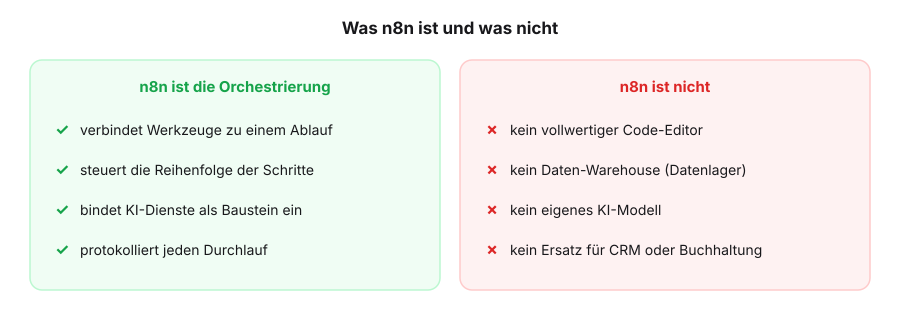
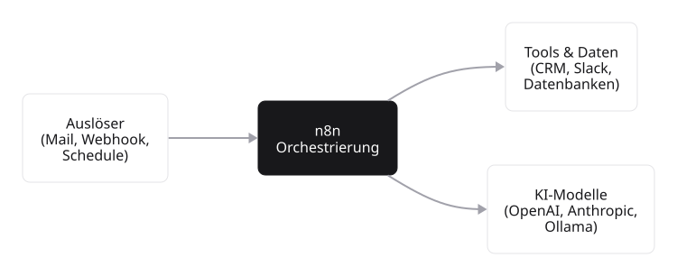

# Was n8n leistet

Dieses Kapitel erklärt das Funktionsprinzip von n8n. Wir beginnen mit einem konkreten Anwendungsfall, bevor wir uns Pricing, Hosting und Tool-Vergleichen zuwenden.

## Ein konkreter Anwendungsfall

Über das Kontaktformular einer Website geht eine Nachricht ein. Drei Schritte sollen automatisch ablaufen, ohne dass eine Person den Vorgang manuell anstößt:

1. **Auslöser:** Eine neue Nachricht trifft über das Kontaktformular ein.
2. **Antworten:** Eine Bestätigungs-E-Mail geht zurück: „Vielen Dank, wir melden uns innerhalb eines Werktags."
3. **Festhalten:** Die Nachricht landet in einer Tabelle, damit das Team sie später bearbeiten kann.

Für solche wiederkehrenden Abläufe ist n8n gebaut, etwa für Kontaktformulare, eingehende Rechnungen oder ein wöchentliches Reporting. Im Beispiel verbindet ein Workflow drei Werkzeuge (Formular, Postfach und Tabelle) und läuft nach der Einrichtung ohne weiteres Zutun.

## Zwei Kernaufgaben

n8n erfüllt im Kern zwei Aufgaben, die im selben Editor zusammenfallen:

**Daten zwischen Werkzeugen bewegen.** n8n bringt über fünfhundert fertige **Integrationen** mit, also vorbereitete Verbindungen zu externen Anwendungen wie Salesforce, HubSpot, Slack, Microsoft Teams, Notion oder Airtable. Anwendungen mit einer offenen API, also einer dokumentierten Schnittstelle für den automatisierten Zugriff von außen, lassen sich zusätzlich anbinden. Trigger, Schritte und Verbindungen werden im Editor visuell zusammengeklickt. Eigener Code ist möglich, aber nicht nötig.

**KI-Bausteine als Standard mitbringen.** Ein eigener KI-Assistent im Workflow, eine Suche über firmeninterne Dokumente oder manuelle Freigabe-Schritte für sensible Aktionen gehören zur Standardausstattung des Editors. Diese Verbindung von Datenbewegung und KI-Bausteinen unterscheidet n8n von klassischen Automation-Tools.

::: {.callout-tip title="Werkstatt-Analogie für n8n" collapse="true"}
n8n lässt sich gut mit einer gut sortierten Werkstatt vergleichen:

- **Die Werkstatt** ist die n8n-Instanz selbst, also der Raum, in dem alles zusammenläuft.
- **Werkbänke** sind die einzelnen Workflows, jeder für eine bestimmte Tätigkeit eingerichtet.
- **Werkzeuge an der Wand** sind die Knoten (Mail-Knoten, Tabellen-Knoten, KI-Knoten), die je nach Bedarf von der Werkbank gegriffen werden.
- **Strom und Druckluft** sind die Auslöser im Hintergrund, die die Werkstatt überhaupt erst aktivieren, also ein Trigger pro Werkbank.

Die Werkzeuge müssen wir also nicht selbst bauen. Wichtig ist, für jede Aufgabe das passende Werkzeug auszuwählen.
:::

## Was n8n nicht ist

n8n ist kein vollwertiger Code-Editor, kein Data Warehouse (eine zentrale Datenbank für Auswertungen) und kein eigenständiges KI-Modell. Wer eine mehrstufige Datenaufbereitung mit komplexer Logik programmiert, ist mit Python oder spezialisierten Werkzeugen wie dbt und Airflow oft besser aufgehoben.

Das KI-Modell selbst stellt n8n nicht bereit. Es wird als Dienst von OpenAI, Anthropic oder über Ollama angebunden. n8n ist die Schicht **dazwischen**, also die Orchestrierung (Steuerung des Zusammenspiels), die alle anderen Werkzeuge zu einem laufenden Prozess verbindet.

{#fig-n8n-orchestrierung width="80%"}

::: {.callout-note}
n8n verbindet spezialisierte Werkzeuge miteinander. Wer Salesforce, ein eigenes Sprach-Modell, eine Postgres-Datenbank und Slack einsetzt, behält diese Werkzeuge und nutzt n8n als Bindeglied.
:::

## Typische Anwendungsfelder

Drei Aufgabenklassen sind typische Einsatzgebiete für n8n:

1. **Routine-Workflows mit Trigger-Aktion-Datenfluss.** Eine Mail trifft ein, eine Aktion wird ausgeführt, ein Eintrag wird geschrieben. Das ist klassisches Tagesgeschäft im Marketing, im Vertrieb und im Customer-Support.
2. **Hybride Pipelines mit deterministischen und KI-Schritten.** Vor- und Nachverarbeitung laufen deterministisch ab (nach festen Regeln, mit gleichem Ergebnis bei gleicher Eingabe), und mittendrin steht ein KI-Schritt für Klassifikation (also das Zuordnen einer Eingabe zu einer Kategorie), Zusammenfassung oder Antwort-Formulierung.
3. **Wissens-Anwendungen mit eigenen Daten.** RAG-Pipelines (Retrieval-Augmented Generation: Das Sprach-Modell sucht vor der Antwort passende Stellen in eigenen Dokumenten) greifen auf firmeneigene Inhalte zu, statt aus dem allgemeinen Internet-Wissen zu antworten.

Die folgenden Module greifen diese drei Aufgabenklassen jeweils auf und setzen sie Schritt für Schritt mit n8n um.
